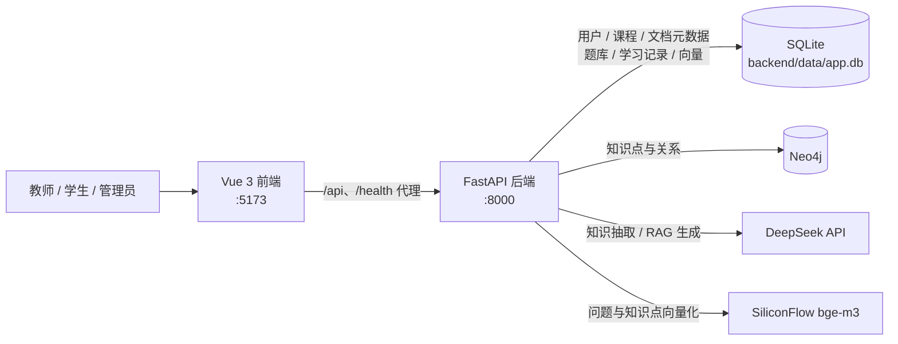

# 基于 AIGC 的课程知识图谱智能构建与学习导航系统

> A10 服务外包大赛参赛项目：课程文档 → LLM 知识抽取 → Neo4j 知识图谱 → 图谱可视化 / RAG 智能问答 / 学习路径推荐 / 题库练习


## 项目简介

系统面向 **教师 / 学生 / 管理员** 三种角色，把课程资料（PDF / DOCX / TXT / Markdown）自动转换为可视化的课程知识图谱，并在图谱之上提供智能问答、学习路径推荐、题库练习与教学监测。

核心链路：

```
课程文档 → 文档解析 → 分块 → LLM 抽取知识点与关系 → Neo4j 知识图谱
                                                        ├── G6 图谱可视化 / 编辑
                                                        ├── RAG 智能问答（bge-m3 + DeepSeek）
                                                        ├── 学习路径 / 前置知识推荐
                                                        └── 试题自动挂载知识点
```

## 核心功能

### 教师端

- **课程管理**：创建课程、加入码、邀请链接、成员审批；协作教师共同维护图谱
- **文档管理**：单个 / 批量上传 PDF、DOCX、TXT、MD（≤ 50 MB），在线预览，抽取失败可重试
- **知识抽取**：LLM 自动抽取实体（概念 / 定理 / 公式 / 方法）与四类关系（`CONTAINS` / `RELATED_TO` / `APPLIES_TO` / `PRECEDES`）
- **图谱编辑**：AntV G6 力导向图，支持缩放、拖拽、搜索高亮，节点 / 关系的手工增删改
- **题库**：手动出题、批量导入（预览后提交）、试题自动挂载知识点、主观题批改
- **学习监测**：查看学生进度与班级统计

### 学生端

- **课程中心**：按加入码或邀请加入课程，浏览已加入 / 可发现课程
- **文档阅读**：内置 PDF / DOCX 在线阅读器，联动展示该文档的知识点
- **图谱浏览**：查看课程知识图谱、知识点详情、前置知识
- **智能问答**：基于图谱的 RAG 问答，回答附带参考知识点来源
- **学习路径**：按已掌握知识点推荐下一步，或生成到目标知识点的学习路径
- **练习**：做题、错题本、收藏、学习进度与统计

### 管理员端

- **平台治理**：用户管理（启停 / 角色 / 重置密码）、课程治理与转移、资源清理
- **系统监控**：真实请求量、响应耗时与错误统计；审计日志
- **知识融合**：文档级实体消歧候选扫描、人工审核、应用与撤销

## 技术栈

| 层次 | 技术 |
|---|---|
| 后端 | Python 3.12+、FastAPI 0.115、Uvicorn、Pydantic、PyJWT |
| 前端 | Vue 3.5、Vite 7、Pinia、Vue Router、Element Plus、Tailwind CSS 4 |
| 图谱可视化 | AntV G6 5、ECharts 5 |
| 图数据库 | Neo4j（`KnowledgePoint` 节点 + 英文关系类型，`neo4j` 驱动 5.27） |
| 关系型数据库 | SQLite（`backend/data/app.db`，手写 SQL，无 ORM） |
| LLM | DeepSeek `deepseek-chat`（OpenAI 兼容接口） |
| Embedding | SiliconFlow `BAAI/bge-m3`（1024 维，OpenAI 兼容接口） |
| 文档解析 | PyPDF2、pdfplumber、python-docx |
| 测试 | 后端自带断言脚本、13 个评测脚本、Playwright 端到端测试 |

> DeepSeek 不提供 embedding 接口，因此向量化单独使用 SiliconFlow；两者均通过 `openai` SDK 的兼容接口调用。

## 系统架构



## 目录结构

```
知识图谱AI分析/
├── backend/                     # FastAPI 后端
│   ├── app/
│   │   ├── api/                 # 路由层（auth/courses/documents/graph/qa/questions/admin…）
│   │   ├── core/                # 配置、SQLite/Neo4j 单例、鉴权、权限、存储、监控
│   │   ├── services/            # 业务层（抽取、RAG、路径推荐、题库、知识融合…）
│   │   ├── utils/               # 文本预处理
│   │   └── main.py              # 应用入口与路由注册
│   ├── data/                    # app.db / uploads / sample_docs（不入库，首次启动自动创建）
│   ├── test_*.py                # 49 个端到端验证脚本（自带断言）
│   ├── eval_*.py                # 13 个评测脚本（抽取准确率、ANN、题库召回…）
│   ├── eval_data/               # 评测结果 JSON
│   ├── scripts/                 # 数据准备与迁移脚本
│   ├── requirements.txt         # 后端依赖（版本精确锁定）
│   └── .env.example             # 环境变量模板
├── frontend-vue/                # Vue 3 前端（当前唯一前端）
│   ├── src/
│   │   ├── api/                 # 接口封装与响应解包
│   │   ├── components/          # 图谱画布、文档选择器、阅读器、管理端组件
│   │   ├── router/              # 路由与角色守卫
│   │   ├── stores/              # Pinia 状态
│   │   ├── views/               # 教师端 / 学生端 / 课程中心 / 管理员端
│   │   └── main.js
│   ├── tests/                   # Playwright 端到端测试（11 个 spec）
│   ├── vite.config.js           # 开发代理 /api、/health → :8000
│   └── playwright.config.ts
├── docs/                        # 设计与评测文档（见文末索引）
├── md2tex.py                    # Markdown → LaTeX 辅助脚本
├── CLAUDE.md                    # 面向开发者的代码库说明
└── README.md
```

## 快速开始

### 环境要求

- Python 3.12+（当前开发环境为 3.13）
- Node.js ≥ 18
- 本地或远程 Neo4j 5.x 及以上实例（无需 APOC 插件，启动后由后端幂等初始化约束）

### 1. 启动后端

```bash
cd backend

# 安装依赖（版本均已锁定，请勿随意升级 starlette）
pip install -r requirements.txt

# 配置环境变量
cp .env.example .env        # Windows: copy .env.example .env
# 编辑 .env，填入 LLM / Embedding / Neo4j / SECRET_KEY 的真实值

# 启动（在 backend/ 目录下执行）
python -m uvicorn app.main:app --reload
```

- 接口文档：<http://localhost:8000/docs>
- 健康检查：`curl http://localhost:8000/health` → `{"status":"ok"}`
- SQLite 表结构在首次启动时自动创建（`sql_db.init_tables()`），**克隆仓库后无需准备任何数据库文件**

### 2. 启动前端

```bash
cd frontend-vue
npm install
npm run dev        # http://localhost:5173
```

Vite 开发服务器已将 `/api` 与 `/health` 代理到 `http://localhost:8000`，无需额外配置跨域。

生产构建：

```bash
npm run build      # 输出 dist/
```

### 3. 登录账号

引导账号在**后端首次启动时自动创建**：

| 用户名 | 角色 | 口令来源 |
|---|---|---|
| `sysadmin` | 管理员 | `DEFAULT_ADMIN_USERNAME` / `DEFAULT_ADMIN_PASSWORD` |
| `admin` | 教师 | `DEFAULT_TEACHER_PASSWORD`（用户名固定） |

若未配置上述环境变量，系统会随机生成 16 位口令并**只在启动日志中打印一次**，同时要求首次登录后立即改密。学生账号通过注册页（`/register`）创建，默认角色为 `student`。

### 环境变量说明

| 变量 | 说明 |
|---|---|
| `LLM_API_KEY` / `LLM_API_BASE` / `LLM_MODEL` | DeepSeek 抽取与问答生成 |
| `EMBEDDING_API_KEY` / `EMBEDDING_API_BASE` / `EMBEDDING_MODEL` | SiliconFlow `BAAI/bge-m3` 向量化；未配置时 RAG 退回关键词检索 |
| `NEO4J_URI` / `NEO4J_USER` / `NEO4J_PASSWORD` | Neo4j 连接 |
| `SQLITE_DB_PATH` | SQLite 路径，默认 `./data/app.db`（相对 `backend/`） |
| `UPLOAD_DIR` | 课程文档上传目录 |
| `SECRET_KEY` | JWT 签名密钥，部署时务必改为随机长串 |
| `DEFAULT_ADMIN_*` / `DEFAULT_TEACHER_PASSWORD` | 可选，固定引导账号口令 |

## 数据存储

系统使用 **SQLite + Neo4j 双存储**：

| 存储 | 内容 |
|---|---|
| **SQLite**（`backend/data/app.db`） | 用户、课程、课程成员、邀请、文档元数据、题库、作答与批改、学习记录、收藏、个人资料，以及知识点 / 题目向量 |
| **Neo4j** | `KnowledgePoint` 节点及其关系。MERGE 键为 `(course_id, document_id, name)`；关系类型为英文 Cypher 类型（`PRECEDES` / `CONTAINS` / `RELATED_TO` / `APPLIES_TO`），中文名存于 `relation_type` 属性 |

两者之间没有分布式事务，删除课程 / 文档时需要在两侧显式级联清理。`app.db` 与上传文件均不纳入版本库。

## 核心链路说明

### 知识抽取

1. 文档解析为纯文本（PDF / DOCX / TXT / MD）
2. 按约 6000 tokens、400 tokens 重叠分块，并发调用 DeepSeek
3. 每个分块输出实体 / 关系 JSON，经去重、非法端点过滤后写入 Neo4j
4. 抽取提示词中注入学科分类树与关系模式（本体约束抽取）

在四个真实课程章节（105,578 字符 / 189 实体 / 214 关系）上的关系主指标 F1 为 **0.8663 / 0.9079 / 0.8785 / 0.9153，均值 0.8920**，高于赛题 70% 验收线。完整方法与原始数据见 [知识抽取准确率测试报告](docs/知识抽取准确率测试报告.md)。

### RAG 问答

```
问题 → SiliconFlow 向量化 → 与该文档全部知识点向量做余弦排序（top_k）
     → 按 kp_id 回查 Neo4j 获取节点元数据 → 拼入提示词 → DeepSeek 生成
```

返回的 `sources` 就是本次实际喂给模型的上下文，保证答案与引用一致。向量以 JSON 存于 `t_kp_embedding`，文档重新抽取导致 `kp_id` 变化时会自动重建索引。21 题问答测试集与结果见 [问答测试集](docs/问答测试集.md)。

## 验证与评测

项目没有 pytest / jest，使用自带断言的脚本来验证：

```bash
# 后端端到端验证（在 backend/ 目录下执行，输出 通过 N/M）
python test_pipeline.py

# 知识抽取准确率评测（只读，结果写入 eval_data/）
python eval_accuracy.py

# 前端端到端测试（需后端与前端均已启动）
cd frontend-vue
npx playwright test
npx playwright test tests/profile.spec.ts --project=chromium
```

- 后端共 **49 个 `test_*.py`** 验证脚本与 **13 个 `eval_*.py`** 评测脚本；前端有 **11 个 Playwright spec**
- ⚠️ 多数验证脚本会**真实写入** `app.db` 与 Neo4j（创建账号、课程、节点后自行清理）。建议在专用环境运行，跑完核对数据是否复原
- 评测运行步骤见 [评测运行简明教程](docs/评测运行简明教程.md)

## 文档索引

| 文档 | 内容 |
|---|---|
| [需求规格说明书](docs/需求规格说明书.md) | 功能与非功能需求 |
| [需求分析质量验证报告](docs/需求分析质量验证报告.md) | 需求文档质量评分、追溯覆盖、缺陷清单与放行条件 |
| [系统使用说明文档](docs/系统使用说明文档.md) | 三种角色的操作流程 |
| [交付说明](docs/交付说明.md) | 环境依赖、启动、数据与测试账号 |
| [数据库设计](docs/数据库设计.md) | SQLite 表结构与 Neo4j 图模型 |
| [知识抽取准确率测试报告](docs/知识抽取准确率测试报告.md) | 四章基线 / 归因 / 迭代 / 复测全流程 |
| [提示词工程完整记录](docs/提示词工程完整记录.md) | 抽取与问答提示词迭代过程 |
| [问答测试集](docs/问答测试集.md) | 21 题 RAG 测试用例与结果 |
| [题库功能说明](docs/题库功能说明.md) | 组题、导入、判分与作用域 |
| [知识点自动标注设计](docs/知识点自动标注设计.md) | 试题自动挂载知识点的算法与降级策略 |
| [主观题与批改设计](docs/主观题与批改设计.md) | 填空 / 解答题与教师批改 |
| [文档级知识融合与实体消歧实施报告](docs/文档级知识融合与实体消歧实施报告.md) | 候选扫描、审核、应用与撤销 |
| [论文算法复现实验](docs/论文算法复现实验.md) | 召回 / ANN 排序 / 去重对比实验 |
| [问题修复记录](docs/问题修复记录.md) | 真实缺陷的定位与修复过程 |
| [评测运行简明教程](docs/评测运行简明教程.md) | 三步跑通抽取准确率评测 |

更多文档见 [`docs/`](docs/) 目录。
