# 面向课程学习的智能问答与知识检索系统

## 需求规格说明书（SRS）

> 文档编号：SRS-A10-2026-10-18  
> 版本：V1.0（需求基线）  
> 编制日期：2026-10-18  
> 团队名称：**惊蛰破阵曲**  
> 小组编号：**18**  
> 小组成员：郭学毅、梅智杰、蔡善文、徐温骄  
> 项目名称：**面向课程学习的智能问答与知识检索系统**  
> 文档状态：团队内部复核；业务方确认项见 §8.2  
> 编写依据：《学生需求分析与AI智能体使用验证报告》A/B 部分；需求结构图 3.2 / 3.3；当前仓库代码与 `docs/` 既有设计文档  
> 读者：项目团队、指导教师、竞赛评审、后续维护者

> **名称说明**：按本次任务要求，本文档统一使用“面向课程学习的智能问答与知识检索系统”。仓库 `backend/app/core/config.py` 中的 `PROJECT_NAME` 仍为“课程知识图谱智能构建系统”，属于实现层旧标识；是否同步改名不影响本需求基线，列入 §8.2 待确认。

---

## 目录

- [0. 文档说明](#0-文档说明)
- [1. 项目概述](#1-项目概述)
- [2. 用户需求](#2-用户需求)
- [3. 领域与数据](#3-领域与数据)
- [4. 规则与权限](#4-规则与权限)
- [5. 行为与状态](#5-行为与状态)
- [6. 质量要求](#6-质量要求)
- [7. 验收与验证](#7-验收与验证)
- [8. 基线与人机协作](#8-基线与人机协作)
- [附录 A 需求实现状态汇总](#附录-a-需求实现状态汇总)
- [附录 B 待确认问题清单](#附录-b-待确认问题清单)
- [附录 C 缩略语](#附录-c-缩略语)
- [附录 D 业务对象与实现载体映射](#附录-d-业务对象与实现载体映射)

---

## 0. 文档说明

### 0.1 目的

本文档描述“面向课程学习的智能问答与知识检索系统”的业务目标、范围、功能、业务规则、权限、数据、状态与质量要求，作为开发、测试、验收和后续变更的共同基线。

本文档合并了两类信息：

1. **现状事实**：仓库中已经存在的代码路径、接口、数据结构与测试/评测记录；
2. **目标要求**：为了形成完整、可验收的业务闭环，系统应当满足的规则与质量指标。

两者在文中分别标注。**“已实现”只表示代码路径存在，不等于验收通过；“已验证”只表示存在可追溯的测试或评测记录，不等于在所有环境、所有数据上成立。**

### 0.2 编写依据

| 依据 | 用途 | 说明 |
|---|---|---|
| 《学生需求分析与AI智能体使用验证报告》 | 需求规格说明书的编写要求、A/B 报告结构、来源性质与确认状态约定 | 本文件不替代 A/B 报告；A/B 报告中的 ST/SC/PV/V/AI/E 编号可在 §8.5 与本文件互相追溯 |
| 需求结构图 3.2 / 3.3 | 规定本文档必须覆盖的八个部分及详细用例、数据字典、权限矩阵、质量要求、验收与基线要求 | 章节映射见 §0.3 |
| `docs/项目说明3.md` | 赛题目标、原开发计划与指标 | 该文档部分技术描述已过时（如以 Chroma 描述向量库），以当前代码为准 |
| `docs/数据库设计.md` | 数据对象、枚举、约束、级联删除规则 | 当前数据设计的权威文档 |
| `docs/知识抽取准确率测试报告.md` | 抽取质量指标、方法性质与局限 | 评测口径与数字以该报告为准 |
| `docs/知识抽取准确率评测计划.md` | 评测方案、金标准口径、冻结参数 | 与测试报告配套使用 |
| `docs/提示词工程完整记录.md` | 抽取/问答/融合提示词的版本与迭代记录 | 支撑“Prompt 工程记录”交付物与 AI 任务追溯 |
| `docs/问答测试集.md` | 问答正确率、边界诚实性、检索命中率 | 固定 21 题测试集 |
| `docs/题库功能说明.md`、`docs/题库与推荐系统设计.md`、`docs/主观题与批改设计.md` | 题库、练习、推荐、批改规则与评测 | 规则以代码与这些文档交叉核对 |
| `docs/知识点自动标注设计.md` | 自动标注三层证据、阈值与写库闸门 | 含评测数据与弱标签说明 |
| `docs/文档级知识融合与实体消歧实施报告.md` | 融合流程、阈值、审核与回滚 | 文档级融合的权威说明 |
| 当前仓库代码 | 校验上述文档是否仍与实现一致 | 冲突时以代码为准，并在 §7.5 记录差异 |

### 0.3 结构与 3.3 要求落实情况

本文档严格对应需求结构图的八个部分：

| 图片要求的部分 | 本文档章节 |
|---|---|
| 项目概述（问题、业务目标、成功指标、涉众、确认责任、范围和非目标） | §1 |
| 用户需求（用户故事、功能范围、优先级、关键用例） | §2 |
| 领域与数据（术语、核心对象、关系、数据字典） | §3 |
| 规则与权限（允许/禁止/计算规则、角色与对象范围） | §4 |
| 行为与状态（业务过程、生命周期、异常处置） | §5 |
| 质量要求（性能、可靠性、安全等及取舍理由） | §6 |
| 验收与验证（验收场景、来源核对、原型走查、覆盖与一致性、追踪矩阵） | §7 |
| 基线与人机协作（已确认范围、未决问题、人工决策、AI 使用与约束） | §8 |

3.3 的细化要求落实情况：

| 3.3 要求 | 落实位置 | 说明 |
|---|---|---|
| 需求清单覆盖全部必做范围 | §2.3、§2.6 | P0 为本期必做；P1/P2 为已交付增强或体验项 |
| 选择 3–5 个代表性用例，展示完整业务闭环 | §2.5 | UC-01 至 UC-05，覆盖“文档→图谱→问答→学习→组题/练习/批改→治理/融合” |
| 每个用例包含编号、参与者、触发、前置、主流程、替代/异常、成功/失败结果、关联规则、验收标准、频率或触发规律 | §2.5 | 每个用例使用统一 12 项模板 |
| 数据字典含含义、来源、约束、责任/维护、隐私属性、访问规则 | §3.4 | 以业务概念表述，不写数据库实现细节；实现载体见附录 D |
| 权限矩阵同时说明角色与对象范围 | §4.4 | 角色 × 对象/操作矩阵，另附对象范围说明 |
| 质量要求含使用情境、可观察指标、检验方法、依据或待确认 | §6 | NFR-01 至 NFR-21，逐项给出依据/状态 |
| 预期使用频率无数据时标“待确认”，不得编造 | §2.5、附录 B | 所有用例频率均标注触发规律；无使用日志的频次统一标“待确认” |

### 0.4 状态与来源标注约定

**实现/验证状态：**

| 标记 | 含义 | 使用规则 |
|---|---|---|
| 已实现 | 仓库中存在对应代码路径 | 不代表已通过验收；验收结论见 §7 |
| 部分实现 | 主路径存在，但有明确缺口或未覆盖的异常分支 | 缺口在 §5.4 或 §6.4 说明 |
| 已验证 | 存在可追溯的测试脚本、评测报告或运行记录 | 必须注明证据；本次文档编写未重跑的项目会明确写出 |
| 待验证 | 有用例/脚本但本次未执行，或只有设计未验证 | 不得表述为“已通过” |
| 待确认 | 缺少可靠依据，或属于产品/业务取舍 | 不得臆造数值或规则 |
| 不在本期范围 | 明确排除在本次交付之外 | 见 §1.6 |

**来源性质：**

| 标记 | 含义 |
|---|---|
| 原始资料 | 直接来自代码、数据库设计、既有测试/评测报告或需求原文 |
| AI候选 | 由大模型生成的抽取结果、问答、标注或消歧建议，未经人工最终确认 |
| 分析推导 | 本文档编写者根据代码与文档整理出的结论，需团队复核 |
| 人工决策 | 团队或业务方明确做出的范围、规则或取舍决定 |

### 0.5 与 A/B 验证报告的关系

- A 报告《学生需求分析与AI智能体使用验证报告》中的 A.2 关键事实/规则、A.3 图模型、A.4 状态转换（ST-xx）、A.5 场景走查（SC-xx）、A.6 原型验证（PV-xx）、A.7 问题处理（V-xx）、A.8 成员贡献，是本文档的事实来源之一。
- B 报告中的 B.1 工具、B.2 AI 任务记录（AI-xx）、B.3 智能体约束、B.4 证据索引（E-xx），用于说明 AI 使用边界与证据链。
- 本文档是**独立的需求规格说明书**，不替代 A/B 报告，也不把 A/B 报告中的“AI候选”直接升格为已确认需求。A/B 报告中的编号在 §8.5 与本文件的需求编号并列引用。

### 0.6 版本记录

| 版本 | 日期 | 变更说明 | 编制/复核 |
|---|---|---|---|
| V1.0 | 2026-10-18 | 首次形成需求基线：按需求结构图八个部分编写；以当前代码为准校正旧文档中的过时描述；未验证项统一标“待确认” | 惊蛰破阵曲（第18组）：郭学毅、梅智杰、蔡善文、徐温骄 |

---

## 1. 项目概述

### 1.1 问题与背景

课程学习中的知识获取存在四个结构性问题：

1. **资料分散、结构隐式**：课程内容分布在 PDF、TXT、DOCX、Markdown 等文档中，章节、概念、定理、公式、方法之间的先修与包含关系没有被显式表达，教师难以复用，学生难以建立整体框架。
2. **通用问答不可信**：通用大模型可以生成流畅答案，但不保证答案来自本课程资料；学生无法判断回答是否有据，教师也无法核对。
3. **学习路径缺少依据**：学生知道“要学什么”，但不知道“先学什么、下一步学什么”；仅按章节顺序推荐，容易把“叙述顺序”误当成“学习依赖”。
4. **教学闭环断裂**：知识点、题目、练习、错题、批改、掌握度各自分散，教师难以判断“哪些知识点没有题”“哪些学生卡在哪里”，学生也难以获得针对薄弱点的练习。

本系统以“课程文档 → 知识图谱 → 检索增强问答 → 学习路径 → 题库与练习”为主线，将上述问题收敛到同一套课程、文档、知识点与学习数据模型上。

### 1.2 业务目标

| 编号 | 业务目标 | 衡量方式 | 关联需求 |
|---|---|---|---|
| G-01 | 降低课程知识结构化成本 | 教师上传文档后自动得到可编辑的知识点与关系；单文档处理时长有明确上限 | FR-C01~C09、NFR-01 |
| G-02 | 提供可追溯的课程问答 | 每次回答返回本次使用的来源；来源与上下文一致；知识库外问题应拒答 | FR-E01~E09、NFR-06 |
| G-03 | 提供有依据的学习路径 | 基于掌握状态与 PRECEDES 前置关系推荐；给出前置知识与目标路径 | FR-F01~F09、NFR-07 |
| G-04 | 打通“知识点—题目—练习—批改”闭环 | 题目可挂知识点；客观题自动判分；主观题教师批改；错题与统计可回看 | FR-G01~G16、NFR-08 |
| G-05 | 支持多角色协作与平台治理 | 课程成员、邀请、审核、移除、管理员治理与审计可用 | FR-B01~B12、FR-I01~I09 |
| G-06 | 保证数据一致性与可恢复性 | 双存储级联清理；WAL；一致性备份；关键操作可审计 | BR-65~BR-68、NFR-10、NFR-19 |

### 1.3 成功指标

> 说明：下表同时给出“赛题/计划目标”“当前证据”和“状态”。没有可靠依据的指标不填写猜测值，统一标“待确认”。评测数据来自开发集或模拟数据，不等同于真实课堂效果。

| 编号 | 指标 | 目标/验收线 | 当前证据 | 依据/状态 |
|---|---|---|---|---|
| SM-01 | 支持文档格式数 | ≥2 种 | PDF/TXT/DOCX/MD 共 4 种 | 代码 `DOC_FILE_TYPES`；已实现 |
| SM-02 | 单章知识点规模 | ≥20 个 | 四章评测 gold 实体 38–62 个；抽取输出同量级 | `知识抽取准确率测试报告.md`；已验证（开发集） |
| SM-03 | 支持关系类型数 | ≥3 种 | `PRECEDES`、`CONTAINS`、`RELATED_TO`、`APPLIES_TO` 共 4 种 | 代码与提示词；已实现 |
| SM-04 | 知识抽取准确率 | 关系 F1 ≥0.70 | 四章关系 F1：0.8663 / 0.9079 / 0.8785 / 0.9153；均值 0.8920 | 评测报告；已验证（开发集，3 轮，本体约束抽取） |
| SM-05 | 单文档处理时长 | ≤60 秒 | 计划书记录单章实测约 41 秒；不同文档/环境差异未系统测量 | 计划书；部分验证，待复测 |
| SM-06 | 图谱交互 | 缩放、拖拽、点击、详情 | 前端图谱组件已实现交互与节点详情 | 代码；已实现，e2e 未在本次编写中重跑 |
| SM-07 | 学习路径推荐 | 可给出下一步与目标路径 | 路径推荐、前置知识、目标路径接口已实现 | 代码与 `test_path_recommender.py`；待验证 |
| SM-08 | 教师手动修正 | 可增删改节点与关系 | 图谱节点/关系 CRUD、手工标记已实现 | 代码；已实现 |
| SM-09 | 多课程/多文档隔离 | ≥2 门独立课程互不串数据 | 以 `course_id + document_id` 隔离；问答/图谱/路径均带作用域 | 代码与隔离测试脚本；待验证 |
| SM-10 | 问答测试集 | ≥20 题 | 21 题：课内 20/20 正确；边界 1/1 拒答；top-3 召回 ≥1 个预期知识点 19/20（95%） | `问答测试集.md`；已验证 |
| SM-11 | 普通 PC 可部署 | 本地启动后端与前端即可演示 | `uvicorn` + Vite 开发模式可运行；容器化/一键部署未纳入仓库流水线 | 代码与 README；部分验证 |
| SM-12 | 前端端到端用例 | 覆盖主要角色与流程 | 11 个 Playwright spec 存在 | `frontend-vue/tests/`；待验证（本次未重跑） |

### 1.4 涉众与确认责任

| 涉众 | 关注点 | 确认责任 | 当前确认状态 |
|---|---|---|---|
| 学生 | 答案是否可信、图谱是否易读、练习是否有针对性、进度是否可见 | 确认学习流程、问答引用呈现、练习与错题体验 | 教学模拟待开展 |
| 教师 | 抽取质量、图谱可修正、题库与批改效率、成员与课程管理 | 确认教学规则、题目与批改口径、课程治理边界 | 教学模拟待开展 |
| 课程创建者 | 课程设置、成员审核、协作教师权限、删除课程的影响 | 确认课程管理规则与删除二次确认 | 团队内部复核 |
| 协作教师 | 与创建者共同管理课程内容，但不能删除课程 | 确认协作权限边界 | 团队内部复核 |
| 平台管理员 | 用户/课程/资源治理、审计、知识融合、系统可用性 | 确认平台治理与融合审核规则 | 团队内部复核 |
| 开发/测试团队 | 需求可实现、可测试、可追溯 | 对需求与代码的一致性负责 | 已复核 |
| 指导教师/竞赛评审 | 交付物完整性、指标真实性、演示效果 | 最终验收与评审 | 待确认 |
| 外部服务提供方 | DeepSeek、SiliconFlow 的可用性与配额 | 不参与需求确认；SLA 与配额待确认 | 待确认 |
| 部署/运维人员 | 环境变量、Neo4j、备份、恢复 | 确认部署与备份方案 | 待确认 |

### 1.5 系统范围

**本期范围（in scope）：**

- 账户注册、登录、改密、注销、个人资料与头像；
- 课程创建、我的课程、发现课程、加课码、公开申请、邀请、成员审核/移除/退出；
- 课程文档上传、解析、LLM 知识抽取、入图、文档列表/详情/在线阅读/删除；
- 知识图谱查询、可视化、节点/关系增删改、手工标记、文档级融合折叠；
- 基于课程文档的 RAG 问答、来源引用、关键词降级；
- 学习状态标记、文档/课程进度、前置知识、下一步推荐、目标路径、知识点收藏；
- 题库（五类题型）、题目校验、题库统计、知识点覆盖率、自动标注、试题文档导入；
- 学生随机练习、智能推荐练习、提交判分、答题记录、错题本、题目收藏；
- 教师主观题批改（单条/批量/汇总）；
- 学生/教师数据总览、教学监测；
- 管理员工作台、用户管理、课程治理、资源管理、系统状态、审计日志；
- 文档级知识融合：扫描、候选审核、应用、撤销、冲突与批次。

**范围外（out of scope）：**

| 排除项 | 原因/边界 |
|---|---|
| Git 仓库历史分析（`git_analyzer.py` / `git_kg_manager.py`） | 代码存在但无 API 路由、前端无界面、计划书未提及；作为孤岛模块不纳入本期需求基线，去留待确认（见 §8.2） |
| 扫描版 PDF 的 OCR | 解析结果为空时按失败处理；不引入 OCR |
| 大模型自动批改主观题 | 主观题只由教师批改；LLM 批改不在本期范围 |
| 作业截止日期、班级/学期、成绩单导出 | 当前无作业与教务模型 |
| 实时协作编辑、聊天、通知 | 当前无实时协同能力 |
| 移动端 App / 小程序 | 当前为桌面浏览器优先的 Vue 前端 |
| 单点登录、LDAP、多租户 SaaS | 当前为单实例、本地账号体系 |
| 跨文档/跨课程知识融合 | 融合严格限定在单个 `(course_id, document_id)` 内 |
| 通用图推理/自动补全 | 仅使用四种关系与路径 BFS，不做通用推理 |
| AI 自动出题 | 题库导入是确定性解析，不调用 LLM 生成题目 |
| 公网内容抓取/版权内容自动采集 | 课程资料由教师上传 |

### 1.6 非目标

以下内容不是本系统的成功标准，也不应作为验收阻断项：

- 替代教师做教学判断或给出成绩结论；
- 保证大模型回答在所有课程、所有问题上都正确；
- 保证跨学科、未见本体的零样本抽取效果；
- 提供完整的学习管理系统（LMS）能力（排课、学籍、教务、通知）；
- 提供高可用、多活、跨地域部署；
- 对所有浏览器、所有移动设备做同等体验保证。

### 1.7 系统上下文

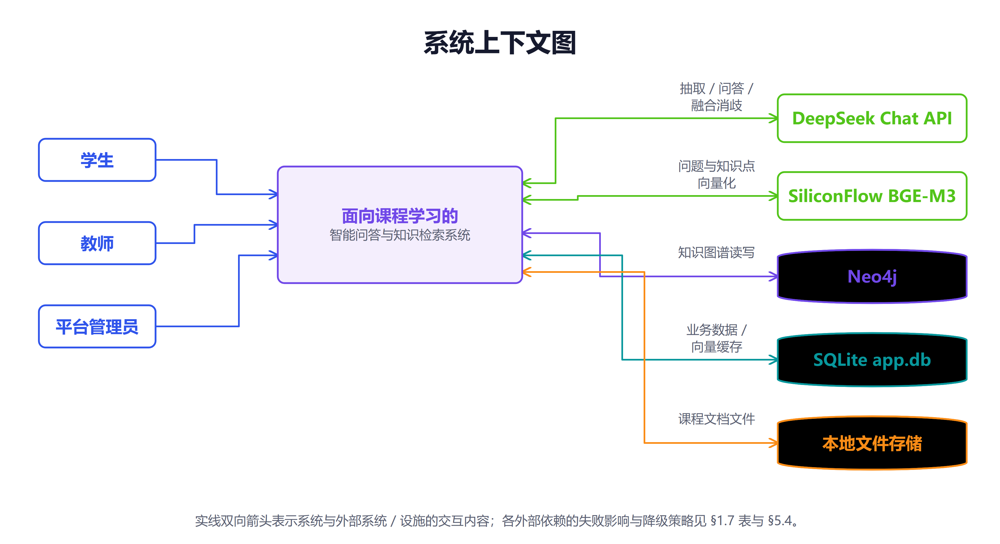

| 外部系统/设施 | 交互内容 | 失败时的影响 | 当前降级策略 |
|---|---|---|---|
| DeepSeek Chat API | 实体/关系抽取、问答生成、融合候选消歧 | 上传构建失败；问答无法生成；融合复核档无法自动判定 | 抽取失败置 `FAILED` 并返回 3003；问答失败返回明确致歉；融合 LLM 不可用时落入 `UNCERTAIN`，绝不自动判 `SAME` |
| SiliconFlow BGE-M3 | 问题/知识点/题目向量化 | 向量检索不可用 | 问答退回关键词 `CONTAINS` 检索；自动标注的向量层缺失时按可用层加权 |
| Neo4j | 知识点、关系、图谱查询与路径 | 图谱为空/查询失败；构建可能中断 | 部分管理端统计降级为 0；图库查询返回 5002；问答/构建的降级不完整（见 §5.4） |
| SQLite `app.db` | 用户、课程、文档、题库、学习记录、向量 | 全系统不可用 | 单文件数据库；WAL + `busy_timeout=15s`；使用 `backup_to()` 做一致性备份 |
| 本地文件存储 | 原始课程文档与头像 | 在线阅读/重新解析失败 | 文件缺失时返回 2003 等错误；不自动从其他机器恢复 |
| 浏览器 | Vue 前端、PDF/TXT/Markdown 阅读、图谱渲染 | 无法使用界面 | 以现代 Chromium 为主要验证环境；其他浏览器待确认 |

### 1.8 约束与假设

1. **中文为主**：界面、提示词、课程内容以中文为主；英文课程内容可处理，但抽取质量未单独评测。
2. **外部 AI 依赖**：抽取与问答依赖 DeepSeek；向量化依赖 SiliconFlow；未配置密钥时功能降级而非完全可用。
3. **Neo4j 不随仓库分发**：换机器后必须自备 Neo4j 并导入图谱；图谱为空时问答只会得到“知识库没有相关内容”类回答（这是已知的部署陷阱）。
4. **单实例部署**：当前按单机、单进程/少量 worker 设计；向量缓存为进程内缓存，TTL 60 秒，不引入分布式版本表。
5. **数据规模假设**：当前单文档最大约 69 条向量；设计上在 1,000 条/文档以内不引入 ANN；numpy 矩阵在 5,000 条以内与 HNSW 同级。
6. **AI 输出是候选**：抽取结果、自动标注、问答、融合建议都不是“事实”，必须允许人工修正或审核。
7. **课程资料可能被发送到外部 API**：上传文档的文本会进入 DeepSeek 抽取；问答问题与检索上下文会进入 DeepSeek；知识点/题目文本会进入 SiliconFlow。不得上传包含个人敏感信息的材料。
8. **无静态检查/CI**：仓库没有 lint、格式化配置、CI 或 Docker 流水线；“变量名写错、运行期才炸”不会被静态拦住。

---

## 2. 用户需求

### 2.1 用户角色

| 角色 | 定义 | 系统入口 | 关键能力 |
|---|---|---|---|
| 游客 | 未登录用户 | 登录/注册 | 注册学生/教师账号；登录 |
| 学生 | 账号角色 `student` | 课程中心 → 学生视图 | 加入课程、读文档、看图谱、问答、学习路径、练习、错题、收藏、个人资料 |
| 课程创建者 | 创建课程的教师（`teacher_id` 本人） | 教师视图 | 课程设置、上传/删除文档、编辑图谱、成员/邀请/加课码、题库、批改、监测、删除课程 |
| 协作教师 | 以教师角色加入课程的已通过成员 | 教师视图 | 与创建者共同管理课程内容与题库；不能删除课程；可被创建者移除 |
| 平台管理员 | 账号角色 `admin` | 管理员端 | 用户/课程/资源治理、系统状态、审计、知识融合；不承担课程教学角色 |

> **账号角色与课程角色是两套概念**：账号角色决定“能进哪个端”；课程角色/成员状态决定“能看哪门课、能做什么”。教师账号加入他人课程时一律以协作教师身份进入待审核，不能以学生身份加入。

### 2.2 用户故事清单

| 编号 | 角色 | 用户故事 | 优先级 | 关联需求 |
|---|---|---|---|---|
| US-01 | 游客 | 作为学生/教师，我希望注册并登录，以便进入系统 | P0 | FR-A01、A02 |
| US-02 | 用户 | 作为用户，我希望维护个人资料与头像，以便课程成员识别我 | P1 | FR-A05、A06 |
| US-03 | 用户 | 作为用户，我希望修改密码或注销账号，以便保护账号安全 | P0 | FR-A03、A04、A07 |
| US-04 | 教师 | 作为教师，我希望创建课程并获得加课码，以便组织教学 | P0 | FR-B01、B10 |
| US-05 | 学生/教师 | 作为用户，我希望看到我的课程和可发现的公开课，以便选择学习/协作 | P0 | FR-B02、B03 |
| US-06 | 学生/教师 | 作为用户，我希望通过加课码、申请或邀请加入课程，以便获得课程内容 | P0 | FR-B04、B05、B06 |
| US-07 | 学生 | 作为学生，我希望看到申请状态和审核意见，以便知道下一步 | P0 | FR-B12 |
| US-08 | 教师 | 作为教师，我希望审核、拒绝、移除成员，以便管理课程成员 | P0 | FR-B07、B08 |
| US-09 | 教师 | 作为教师，我希望上传课程文档并自动构建知识图谱，以便减少手工整理 | P0 | FR-C01~C04 |
| US-10 | 教师 | 作为教师，我希望看到文档解析/抽取状态和失败原因，以便处理问题 | P0 | FR-C08 |
| US-11 | 学生/教师 | 作为课程成员，我希望在线阅读原文档，以便对照原文学习 | P1 | FR-C05、C06 |
| US-12 | 学生/教师 | 作为课程成员，我希望浏览、缩放、拖拽知识图谱，以便理解知识结构 | P0 | FR-D01、D02 |
| US-13 | 学生 | 作为学生，我希望查看知识点详情与关系，以便深入理解 | P0 | FR-D03 |
| US-14 | 教师 | 作为教师，我希望增删改知识点与关系，以便修正抽取结果 | P0 | FR-D04~D06 |
| US-15 | 学生 | 作为学生，我希望就当前课程提问，以便快速获得课程内答案 | P0 | FR-E01~E05 |
| US-16 | 学生 | 作为学生，我希望看到回答引用了哪些知识点，以便核对可信度 | P0 | FR-E06、E08 |
| US-17 | 学生 | 作为学生，我希望标记掌握/学习中并查看进度，以便跟踪学习 | P0 | FR-F01~F04 |
| US-18 | 学生 | 作为学生，我希望看到前置知识、下一步推荐和目标路径，以便规划学习 | P0 | FR-F05~F07、F09 |
| US-19 | 学生 | 作为学生，我希望收藏知识点，以便之后复习 | P2 | FR-F08 |
| US-20 | 教师 | 作为教师，我希望创建和编辑五类题目并挂知识点，以便组织练习 | P1 | FR-G01~G03 |
| US-21 | 教师 | 作为教师，我希望查看题库统计和知识点覆盖率，以便发现缺题 | P1 | FR-G04、G05 |
| US-22 | 教师 | 作为教师，我希望对题目候选知识点自动标注，以便减少手工挂载 | P1 | FR-G06、G07 |
| US-23 | 教师 | 作为教师，我希望从试题文档批量导入题目，以便快速建库 | P1 | FR-G08 |
| US-24 | 学生 | 作为学生，我希望按课程/文档/题型/数量随机练习，以便自测 | P0 | FR-G09、G15 |
| US-25 | 学生 | 作为学生，我希望获得针对薄弱点的推荐练习，以便高效复习 | P1 | FR-G10 |
| US-26 | 学生 | 作为学生，我希望提交作答并查看判分/解析，以便及时反馈 | P0 | FR-G11、G15 |
| US-27 | 学生 | 作为学生，我希望查看答题记录、错题本和统计，以便复盘 | P1 | FR-G12、G13 |
| US-28 | 教师 | 作为教师，我希望批改主观题并查看待批列表，以便完成教学闭环 | P0 | FR-G14 |
| US-29 | 教师 | 作为教师，我希望查看成员学习进度与课程统计，以便教学监测 | P1 | FR-H01~H03 |
| US-30 | 管理员 | 作为管理员，我希望管理用户账号与角色，以便平台安全运营 | P1 | FR-I01、I02 |
| US-31 | 管理员 | 作为管理员，我希望治理课程（下架/归档/关闭/转移/删除），以便处理异常课程 | P1 | FR-I03 |
| US-32 | 管理员 | 作为管理员，我希望管理资源、查看系统状态与审计日志，以便运维与追责 | P1 | FR-I04~I06 |
| US-33 | 管理员 | 作为管理员，我希望审核并应用文档级知识融合，以便消除同文档内的重复实体 | P1 | FR-I07~I09 |
| US-34 | 学生/教师 | 作为课程成员，我希望不同课程/文档的数据互不串扰，以便安全学习 | P0 | FR-C09、D01、E01、F09、G01 |

### 2.3 功能需求清单

> **状态说明**：以下“已实现”表示代码路径存在；“部分实现”表示主路径存在但有明确缺口；“待验证”表示已有脚本/用例但本次未执行。优先级 P0 为本期必做，P1 为已交付增强，P2 为体验项。

#### 2.3.1 账户与个人资料

| 编号 | 需求 | 优先级 | 状态 | 边界/备注 |
|---|---|---|---|---|
| FR-A01 | 系统应允许自助注册学生/教师账号；用户名唯一；密码非空；角色仅限 `student`/`teacher` | P0 | 已实现 | 注册接口不接受 `admin` |
| FR-A02 | 系统应支持用户名+密码登录，签发 24 小时 JWT，返回用户 id/用户名/角色/展示名/是否需改密 | P0 | 已实现 | 停用/注销账号拒绝登录 |
| FR-A03 | 系统应支持修改密码：校验原密码；新密码至少 6 位；不得与原密码相同；成功后清除强制改密标记 | P0 | 已实现 | 错误码 1001/2003 |
| FR-A04 | 当账号被标记“必须改密”时，前端应强制进入改密页，未完成前不能进入业务页面 | P0 | 已实现 | 管理员重置密码/引导账号首次登录会置位 |
| FR-A05 | 用户应能查看/编辑本人资料：昵称、真名、性别、学校、学院、专业、年级、班级、学号/工号、职称、研究方向、简介 | P1 | 已实现 | 仅本人可改；教师可在成员列表看到课程成员资料 |
| FR-A06 | 用户应能上传/替换头像；头像不超过 2MB，扩展名在白名单内 | P2 | 已实现 | 头像 URL 存于个人资料 |
| FR-A07 | 用户应能在校验密码后注销账号；注销为停用，不物理删除历史数据 | P1 | 已实现 | 管理员可重新启用 |

#### 2.3.2 课程与成员

| 编号 | 需求 | 优先级 | 状态 | 边界/备注 |
|---|---|---|---|---|
| FR-B01 | 教师应能创建课程：课程名必填；可填课程代码、描述、组织、分类、封面；默认 `join_mode=approval`、`is_public=1`；系统生成唯一 8 位加课码；创建者自动成为已通过教师成员 | P0 | 已实现 | 仅教师可创建 |
| FR-B02 | 用户应能查看“我的课程”，包含课程信息、本人角色/成员状态、成员数/学习进度；加课码只对课程管理者返回 | P0 | 已实现 | 学生/教师视图不同 |
| FR-B03 | 学生应能发现公开课程：仅显示 `is_public=1`、`status=1`、`governance_status=normal` 的课程；支持关键字/分类/组织/加入方式筛选；排除已加入/待审核课程 | P0 | 已实现 | 教师非成员不能读他人课程元数据 |
| FR-B04 | 用户应能通过加课码加入课程，规则见 BR-11 | P0 | 已实现 | 加课码无效 4005；关闭加入 4006 |
| FR-B05 | 学生应能对公开课程提交加入申请：填写理由（≤200 字），进入待审核 | P0 | 已实现 | 非公开/不可见课程 4003 |
| FR-B06 | 教师应能创建邀请链接：选择学生/教师角色、有效期 1–365 天（默认 7 天）；邀请一次性使用；支持预览、接受、撤销 | P0 | 已实现 | 接受邀请直接通过；治理异常课程拒绝 |
| FR-B07 | 教师应能查看课程成员列表，按状态/角色/关键字筛选，分页大小上限 100；展示成员进度与收藏数 | P0 | 已实现 | 进度依赖 Neo4j，图库不可用时总知识点为 0 |
| FR-B08 | 教师应能审核/拒绝/移除成员；学生应能主动退出课程；移除需二次确认 | P0 | 已实现 | 创建者不可被拒绝/移除/退出；移除保留学习记录 |
| FR-B09 | 教师应能编辑课程名称、描述、组织、分类、封面、加入方式、公开性 | P0 | 已实现 | 加课码不在此接口修改 |
| FR-B10 | 教师应能刷新加课码，旧码立即失效 | P1 | 已实现 | 仅课程管理者 |
| FR-B11 | 课程创建者应能删除课程：必须显式确认；级联清理业务库与图库；返回删除统计 | P0 | 已实现 | 仅创建者；不可恢复 |
| FR-B12 | 待审核/被拒绝/被移除的用户应能查看自己的申请状态、审核意见与课程基本信息，但不能读取课程内容 | P0 | 已实现 | 元数据级权限 |

#### 2.3.3 文档与知识构建

| 编号 | 需求 | 优先级 | 状态 | 边界/备注 |
|---|---|---|---|---|
| FR-C01 | 课程管理者应能上传文档：支持 PDF/TXT/DOCX/MD；单文件 ≤50MB；非空；文件名只保留 basename；课程必须存在 | P0 | 已实现 | 格式 1001、大小 1002、空文件 1003 |
| FR-C02 | 系统应解析文档文本，并按 `UPLOADED → PARSING → PARSED/FAILED` 记录解析状态 | P0 | 已实现 | 解析为空按失败 2005 |
| FR-C03 | 系统应调用 LLM 分块抽取知识点与关系：分块上限 6000 tokens、重叠 400 tokens、并发 4；实体类别为概念/定理/公式/方法；关系类型为四种 | P0 | 已实现 | 抽取结果含名称、类别、描述、证据、置信度 |
| FR-C04 | 系统应将抽取结果写入 Neo4j：MERGE 键为 `(course_id, document_id, name)`；`kp_id` 全局唯一；关系类型白名单；禁止自环 | P0 | 已实现 | 同课程不同文档同名节点独立 |
| FR-C05 | 课程成员应能查看文档列表与详情：文件名、类型、大小、解析/抽取状态、实体/关系计数、时间 | P0 | 已实现 | 非成员 4003 |
| FR-C06 | 课程成员应能在线阅读原始文档：返回正确 Content-Type、`inline` 展示、支持 Range 请求；不泄露服务器路径 | P1 | 已实现 | 文档不存在 404；无权限 HTTP 403 |
| FR-C07 | 课程管理者应能删除文档：级联清理图节点/关系、向量、学习记录、收藏、答题、题目、融合数据、本地文件与文档记录 | P0 | 已实现 | 返回各类删除计数 |
| FR-C08 | 教师应能看到解析/抽取状态、错误信息与计数；失败后可删除并重新上传 | P0 | 部分实现 | 入图阶段异常可能未落 `FAILED`，见 §5.4 |
| FR-C09 | 系统应保证课程+文档级隔离：图谱、问答、路径、题目默认按 `(course_id, document_id)` 过滤 | P0 | 已实现 | 课程通用题 `document_id` 为空，作用域不同 |

#### 2.3.4 知识图谱

| 编号 | 需求 | 优先级 | 状态 | 边界/备注 |
|---|---|---|---|---|
| FR-D01 | 课程成员应能查询某文档的知识图谱：`course_id`、`document_id` 必填；节点上限 1–2000（默认 500）；可按类别过滤；返回节点与边 | P0 | 已实现 | 非成员 4003；图库不可用 5002 |
| FR-D02 | 前端应支持图谱缩放、拖拽、点击；按类别区分节点；显示关系标签；点击节点打开详情 | P0 | 已实现 | 前端能力，e2e 未在本次重跑 |
| FR-D03 | 用户应能查看知识点详情：名称、类别、描述、置信度、是否手工创建、融合别名 | P0 | 已实现 | 融合别名用于保持图谱与问答一致 |
| FR-D04 | 课程管理者应能新建/编辑/删除知识点；类别只能是四类；删除节点应连带删除关系 | P0 | 已实现 | 非法类别：新建回退“概念”，编辑拒绝 |
| FR-D05 | 课程管理者应能新建/编辑/删除关系；类型必须在白名单内；禁止自环；删除按 `elementId` 定位 | P0 | 已实现 | 非法类型 4001 |
| FR-D06 | 手工创建/修改的节点应标记 `is_manual=1`，并在融合中禁止作为被折掉的源节点 | P0 | 已实现 | 保护教师手工成果 |
| FR-D07 | 读图应支持文档级融合折叠：默认只显示规范节点；管理员可查看原始图与折叠图 | P1 | 已实现 | 源节点仍保留在 Neo4j |
| FR-D08 | 系统应提供图谱统计：节点数、边数、类别分布、关系类型分布、平均度 | P1 | 已实现 | 管理端/数据总览使用 |

#### 2.3.5 智能问答

| 编号 | 需求 | 优先级 | 状态 | 边界/备注 |
|---|---|---|---|---|
| FR-E01 | 学生应能就课程/文档提问；指定课程时校验内容权限；未指定课程时只检索本人可访问课程 | P0 | 已实现 | 问题为空 4001 |
| FR-E02 | 系统应优先使用 BGE-M3 向量检索：问题向量与知识点向量做余弦相似度，默认 top-k=5 | P0 | 已实现 | numpy 矩阵 + 进程内缓存，TTL 60 秒 |
| FR-E03 | 系统应在每次问答前做索引新鲜度检查：文档当前 `kp_id` 集合（含融合 epoch）与已存向量不一致时重建；不得“有向量就跳过” | P0 | 已实现 | 重新抽取会整体更换 `kp_id` |
| FR-E04 | 向量化不可用/失败时，系统应退回关键词 `CONTAINS` 检索，并记录 warning；结果不足时用同文档节点补足，排除融合源节点 | P0 | 已实现 | 未配置 key 或网络失败均走此路径 |
| FR-E05 | 系统应把检索上下文拼入提示词，调用 DeepSeek 生成回答：temperature=0.3、max_tokens=1024、超时 15 秒 | P0 | 已实现 | 生产抽取温度与评测温度不一致，见 §7.5 |
| FR-E06 | 回答应同时返回 `sources`：本次喂给 LLM 的知识点列表；`sources` 与上下文必须一致；一次提问只检索一次 | P0 | 已实现 | 禁止“先取答案再单独检索一遍” |
| FR-E07 | 上下文不足或问题超出课程知识库时，系统应明确说明无法回答，不得编造 | P0 | 已实现 | 由系统提示词约束 |
| FR-E08 | 融合后问答应与图谱一致：检索命中源节点时折到规范节点；上下文中显示“又称”别名 | P1 | 已实现 | 关键词路径也要折叠 |
| FR-E09 | 问答链路应在线程池中执行，避免同步 HTTP/Neo4j/SQLite 阻塞事件循环 | P0 | 已实现 | `asyncio.to_thread` |

#### 2.3.6 学习记录与路径

| 编号 | 需求 | 优先级 | 状态 | 边界/备注 |
|---|---|---|---|---|
| FR-F01 | 学生应能标记知识点为 `MASTERED`/`LEARNING`/`RECOMMENDED`，可设置 0–100 掌握度；同一用户+课程+知识点唯一；知识点必须存在 | P0 | 已实现 | 来源 `MANUAL` |
| FR-F02 | 学生应能取消本人对某知识点的标记 | P0 | 已实现 | 删除本人记录 |
| FR-F03 | 学生应能查看某文档的学习进度：知识点总数、已掌握数、已掌握 kp_id、进度百分比、记录列表 | P0 | 已实现 | 总数为 0 时进度 0 |
| FR-F04 | 未指定文档时，学生应能查看按课程分组的本人学习记录与进度 | P1 | 已实现 | 只返回本人数据 |
| FR-F05 | 学生应能查询某知识点的前置知识：沿 `PRECEDES` 入边递归最多 5 层；无 `PRECEDES` 时降级返回 `CONTAINS` 上层概念 | P0 | 已实现 | `A -[:PRECEDES]-> B` 表示先学 A |
| FR-F06 | 学生应能获得下一步推荐：无已掌握→根节点；有已掌握→所有前置已掌握且未掌握的后继；按前置数量降序；最多 10 个；无候选时回退根节点 | P0 | 已实现 | 需文档作用域 |
| FR-F07 | 学生应能获得到达目标知识点的路径：根→目标、最多 10 条边、最多 5 条；无 `PRECEDES` 路径时返回目标 + `RELATED_TO` 相关概念 | P0 | 已实现 | 仅建议，不强制 |
| FR-F08 | 学生应能添加/取消/查看知识点收藏；添加幂等；取消只删本人记录 | P2 | 已实现 | 清理个人数据不要求成员身份 |
| FR-F09 | 路径/进度接口在指定课程时应校验成员；未指定课程时应使用可访问课程列表，禁止全库扫描 | P0 | 已实现 | `allowed_course_ids` |

#### 2.3.7 题库、练习与批改

| 编号 | 需求 | 优先级 | 状态 | 边界/备注 |
|---|---|---|---|---|
| FR-G01 | 教师应能创建/编辑/删除五类题目：单选、多选、判断、填空、解答；题目可关联课程/文档/知识点 | P0 | 已实现 | 仅课程教师可管理 |
| FR-G02 | 系统应校验题目：题干/解析≤1000 字；难度 1–5；填空≤20 空；每空答案≤200 字；解答参考答案≤4000 字；单题知识点≤10；单选答案恰好 1 个 | P0 | 已实现 | 非法输入 1001 |
| FR-G03 | 教师应能分页查看题库、按文档/知识点/题型/关键字/启停筛选；教师视图包含答案、解析、作答统计、收藏数 | P0 | 已实现 | 分页上限 100 |
| FR-G04 | 教师应能查看题库统计：题量、启用/停用、题型分布、作答总数、平均正确率、收藏总数 | P1 | 已实现 | 正确率只算已批改 |
| FR-G05 | 教师应能查看知识点覆盖率：有启用题的知识点数/知识点总数、无题知识点清单、悬空 kp_id、未挂题数；图库不可用时降级 | P1 | 已实现 | 只统计启用题 |
| FR-G06 | 教师应能对单题或批量题目生成候选知识点：字面/向量/图谱三层证据，权重 0.45/0.45/0.10，按可用层加权平均；返回 top-5 与置信度 | P1 | 已实现 | 候选门槛 0.30；graph_only 0.01 |
| FR-G07 | 自动标注写库必须满足六道闸门：显式 apply、默认 only_missing、分数≥0.60、kp 在课程清单且非 graph_only、合并而非覆盖、单题≤10 | P1 | 已实现 | 默认只给建议，不写库 |
| FR-G08 | 教师应能从“题目区+答案区”文档导入题目：确定性解析、不调用 LLM；质量状态 READY/NEEDS_REVIEW/ANSWER_MISSING；预览后提交；按题干去重；默认暂存 | P1 | 已实现 | 记录 `import_batch_id` |
| FR-G09 | 学生应能随机练习：按课程/文档/题型/知识点筛选，数量 1–50；不返回答案/解析；只出启用题 | P0 | 已实现 | 无题时返回空/降级提示 |
| FR-G10 | 学生应能获得智能推荐练习：7 个信号加权、6 种模式、mixed 四桶配比、同知识点配额、返回推荐理由；默认排除主观题；seed 可复现 | P1 | 已实现 | 权重与阈值见 CR-05 |
| FR-G11 | 学生应能提交作答：客观题服务端自动判分；主观题落待批改；答案与解析仅在提交后下发；主观题批改后才下发参考答案 | P0 | 已实现 | 主观题提交返回 `correct_answer=null` |
| FR-G12 | 学生应能查看答题记录、错题本、练习统计：记录追加式；错题本取每题最近一次；正确率只算已批改 | P1 | 已实现 | 记录上限 500 |
| FR-G13 | 学生应能添加/取消/查看题目收藏 | P2 | 已实现 | 幂等 |
| FR-G14 | 教师应能查看待批改列表、单条批改、批量批改、批改汇总；分数 0–100；≥60 记正确；重批覆盖；仅主观题 | P0 | 已实现 | 客观题不允许人工批改 |
| FR-G15 | 学生出题/列表/收藏接口不得返回答案与解析；只有提交后才返回 | P0 | 已实现 | 防泄题 |
| FR-G16 | 教师应能停用题目；已作答题目删除时只软删/停用，未作答可物理删除；子表先清理 | P1 | 已实现 | 保护答题历史 |

#### 2.3.8 数据总览与教学监测

| 编号 | 需求 | 优先级 | 状态 | 边界/备注 |
|---|---|---|---|---|
| FR-H01 | 学生应能查看本人数据总览：可访问课程、学习进度、答题数、正确率、错题数、收藏数 | P1 | 已实现 | 只统计本人 |
| FR-H02 | 教师应能查看课程教学监测：成员列表、成员进度、平均进度、掌握数、收藏数 | P1 | 已实现 | 图库不可用时进度降级 |
| FR-H03 | 教师应能查看课程统计：文档数、节点/边数、类别分布、关系类型分布、题目数、覆盖率 | P1 | 已实现 | 管理端/数据总览口径可能不同 |

#### 2.3.9 管理员端

| 编号 | 需求 | 优先级 | 状态 | 边界/备注 |
|---|---|---|---|---|
| FR-I01 | 管理员应能查看平台工作台：用户/课程/资源/抽取任务等概览 | P1 | 已实现 | 仅管理员 |
| FR-I02 | 管理员应能管理用户：列表/详情/编辑/启用/禁用/改角色/重置密码/删除；只有无业务数据的账号可物理删除 | P1 | 已实现 | 删除有业务数据账号 → 2002，引导禁用 |
| FR-I03 | 管理员应能管理课程：列表/详情/下架/恢复/归档/取消归档/关闭/重开/转移/删除 | P1 | 已实现 | 治理状态与业务状态正交 |
| FR-I04 | 管理员应能管理资源：文档列表/详情/删除；查看抽取任务状态并按失败筛选 | P1 | 已实现 | 删除文档走同一级联实现 |
| FR-I05 | 管理员应能查看系统状态：业务库/图库/AI/向量服务可用性与关键计数 | P1 | 已实现 | 具体字段以页面为准 |
| FR-I06 | 管理员应能查看审计日志：操作人、动作、对象、结果、详情、时间；支持筛选与分页；失败也记录；dry-run 不记录 | P1 | 已实现 | 不记录密码 |
| FR-I07 | 管理员应能查看文档级融合概览与只读图：原始/折叠节点边数、候选、映射、冲突、批次；可切换原始/折叠 | P1 | 已实现 | 管理员不是课程成员，使用专用接口 |
| FR-I08 | 管理员应能扫描融合候选、人工审核（通过/驳回/暂缓）、预览并应用融合、撤销单条/整批、查看冲突 | P1 | 已实现 | apply 默认 dry-run；正式需 confirm |
| FR-I09 | 融合接口必须逐端点校验管理员；文档必须属于课程；候选双方必须属于该文档；跨文档/跨课程拒绝 | P1 | 已实现 | 4003 |

### 2.4 用例图

  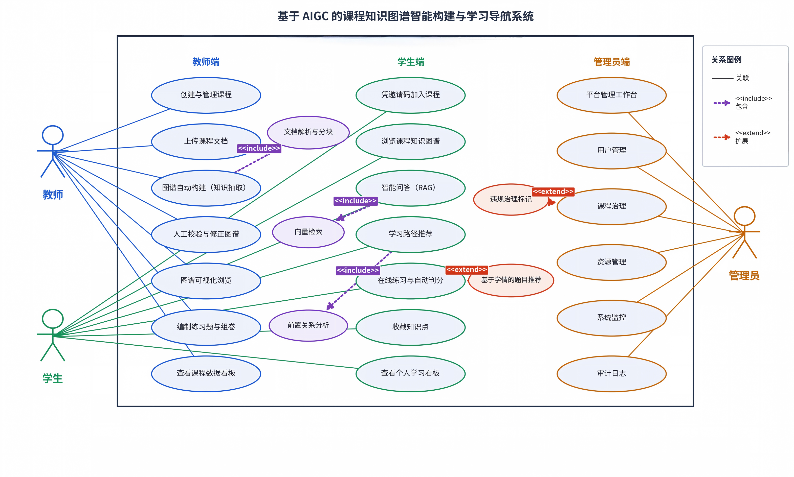

### 2.5 详细用例

以下 5 个用例覆盖“课程资料进入系统 → 图谱构建 → 可信问答 → 学习路径 → 题库/练习/批改 → 平台治理/融合”的完整业务闭环。每个用例的主流程、异常流程、成功/失败结果、关联规则与验收标准均可独立测试。

#### 2.5.1 UC-01 教师上传课程文档并构建知识图谱

| 项目 | 内容 |
|---|---|
| **编号与名称** | UC-01 教师上传课程文档并构建知识图谱 |
| **参与者** | 主参与者：课程创建者或协作教师；支撑系统：文档解析器、DeepSeek、Neo4j、SQLite、本地文件存储 |
| **触发事件** | 教师在课程文档页选择文件并提交上传 |
| **前置条件** | 教师已登录；账号角色为 `teacher`；课程存在；教师是课程创建者或已通过的协作教师；课程未被平台下架/归档（以管理规则为准） |
| **主流程** | 1) 教师选择课程与文件，提交上传。 2) 系统校验登录态、教师角色与课程管理权限。 3) 系统校验扩展名（PDF/TXT/DOCX/MD）、文件非空、大小≤50MB，并清洗文件名为 basename。 4) 系统创建文档记录，保存文件到课程目录，回填文件路径。 5) 系统解析文本：`UPLOADED → PARSING → PARSED`。 6) 系统调用 LLM 分块抽取实体/关系：`PENDING → EXTRACTING`。 7) 系统校验关系类型、过滤非法/悬空端点，按 MERGE 键写入 Neo4j。 8) 系统回填实体数/关系数，置 `COMPLETED`，返回文档 id 与统计。 9) 教师在图谱页查看节点/边；课程成员可读该文档图谱。 |
| **替代流程** | A1 教师选择 `.pptx`/`.xlsx` 等不支持格式 → 返回 1001，不创建文档记录。 A2 文件为空 → 返回 1003，不创建文档记录。 A3 文件超过 50MB → 返回 1002，不创建文档记录。 A4 教师不是课程管理者 → 返回 4003。 A5 解析结果为空（如扫描版 PDF 无文本层）→ 解析置 `FAILED`，返回 2005，不进入抽取。 A6 抽取返回错误或 JSON 解析失败 → 抽取置 `FAILED`，返回 3003，不写入半成品统计。 A7 教师在抽取完成前刷新页面 → 可看到 `PARSING`/`EXTRACTING` 状态；当前上传为同步请求，刷新不会取消后端处理。 |
| **异常流程** | E1 文件保存失败（磁盘/权限）→ 返回 5001；**当前实现可能留下无文件的文档记录**，需要清理（见 §5.4 缺口 G-03）。 E2 Neo4j 不可用或入图异常 → 当前异常会向上抛出，文档可能停留在 `EXTRACTING`；**目标行为**是置 `FAILED` 并返回明确错误，允许删除重传（见 §5.4 缺口 G-01）。 E3 LLM 超时/限流 → 抽取置 `FAILED`，错误信息写入文档记录，返回 3003。 |
| **成功后的结果** | 文档 `parse_status=PARSED`、`extract_status=COMPLETED`；实体/关系计数>0；图谱可按 `(course_id, document_id)` 查询；其他文档数据不受影响。 |
| **失败后的结果** | 文档记录保留（除格式/大小/空文件校验失败外），状态为 `FAILED` 或停留在异常状态；错误信息可见；教师可删除文档后重传；系统不得把失败伪装成“0 个知识点”的成功。 |
| **关联需求与规则** | FR-C01~C09、FR-D01、BR-19~BR-28、BR-65；NFR-01、NFR-10、NFR-12 |
| **验收标准** | AC-01、AC-02、AC-03 |
| **预期使用频率/触发规律** | 触发规律：教师新增或替换课程资料时。具体频次无使用日志，**待确认**；不得按“每学期 N 次”臆造。 |

#### 2.5.2 UC-02 学生基于课程知识库提问并核对来源

| 项目 | 内容 |
|---|---|
| **编号与名称** | UC-02 学生基于课程知识库提问并核对来源 |
| **参与者** | 主参与者：已通过的学生成员；支撑系统：Embedding 服务、Neo4j、DeepSeek、SQLite 向量表 |
| **触发事件** | 学生在问答页输入问题并提交 |
| **前置条件** | 学生已登录；是目标课程的已通过成员；课程/文档存在；问题非空 |
| **主流程** | 1) 学生选择课程/文档（可选）并输入问题。 2) 系统校验课程内容权限；未指定课程时收敛到本人可访问课程。 3) 系统检查索引新鲜度：文档当前 `kp_id` 集合与融合 epoch 对比已存向量，不一致则重建。 4) 系统调用 BGE-M3 向量化问题；在 `VectorIndex` 中做余弦排序，取 top-5。 5) 系统按 `kp_id` 回查 Neo4j 节点元数据，按融合映射折到规范节点，拼接上下文。 6) 系统调用 DeepSeek 生成回答（temperature=0.3、max_tokens=1024、超时 15 秒）。 7) 系统返回 `answer` 与 `sources`；`sources` 就是本次喂给 LLM 的上下文。 8) 学生点击来源卡片核对知识点名称、类别、描述与融合别名。 |
| **替代流程** | A1 未指定 `document_id`：向量检索需要课程+文档作用域，当前会退回关键词检索；结果限定在指定课程或可访问课程内。 A2 未配置 `EMBEDDING_API_KEY` 或 embedding 调用失败：记录 warning，退回关键词 `CONTAINS` 检索；结果不足时用同文档节点补足，并排除融合源节点。 A3 索引不存在或 `kp_id` 集合变化：`ensure_index` 懒重建；重建失败则退回关键词。 A4 问题超出课程知识库：LLM 应按提示词明确拒答，不编造。 A5 融合后命中源节点名称（如旧缩写）：系统折到规范节点，并在上下文中显示“又称”。 |
| **异常流程** | E1 LLM 调用超时/失败 → 返回“抱歉，问答服务暂时不可用：…”的明确文本，不伪造答案；`sources` 仍为本次检索结果。 E2 Neo4j 在元数据回查阶段不可用 → 当前可能直接报错，未统一降级为关键词；见 §5.4 缺口 G-02。 E3 问题为空 → 返回 4001。 E4 用户不是课程成员 → 返回 4003。 |
| **成功后的结果** | 学生得到基于课程知识的回答；来源卡片与回答内容一致；来源数量≤top-k；可回到图谱核对节点。 |
| **失败后的结果** | 明确告知“服务不可用”或“知识库无相关内容”；不得返回无来源的编造答案；不得把向量失败伪装成“知识库为空”。 |
| **关联需求与规则** | FR-E01~E09、BR-29~BR-35、BR-51；NFR-02、NFR-03、NFR-06、NFR-11 |
| **验收标准** | AC-04、AC-05、AC-06 |
| **预期使用频率/触发规律** | 触发规律：学生在预习、复习、做题遇到疑问时随时提问。具体频次无使用日志，**待确认**。 |

#### 2.5.3 UC-03 学生按推荐路径学习并标记掌握

| 项目 | 内容 |
|---|---|
| **编号与名称** | UC-03 学生按推荐路径学习并标记掌握 |
| **参与者** | 主参与者：已通过的学生成员；支撑系统：Neo4j 图谱、路径推荐服务、学习记录表 |
| **触发事件** | 学生在学习页查看进度、前置知识、下一步推荐或目标路径，并标记掌握状态 |
| **前置条件** | 学生是课程成员；课程/文档已构建图谱；目标知识点存在 |
| **主流程** | 1) 学生打开某文档的学习页，系统返回知识点总数、已掌握数、进度百分比与记录列表。 2) 学生选择一个知识点，系统展示其前置知识（沿 `PRECEDES` 入边递归≤5 层；无则展示 `CONTAINS` 上层概念）。 3) 学生点击“标记掌握”，系统校验知识点属于该课程+文档，写入/更新学习记录（`MASTERED`，默认掌握度 100，来源 MANUAL）。 4) 系统刷新进度；同一用户+课程+知识点只保留一条记录。 5) 学生查看“下一步推荐”：无已掌握→根节点；有已掌握→所有前置已掌握且未掌握的后继，按前置数量降序，最多 10 个。 6) 学生可指定目标知识点，系统返回根→目标的 `PRECEDES` 路径（≤10 条边，≤5 条路径）；无路径时返回目标+`RELATED_TO` 相关概念。 7) 学生按推荐继续学习，重复标记与查看。 |
| **替代流程** | A1 学生尚无任何掌握记录 → 推荐根节点（无 `PRECEDES` 入边的节点）。 A2 图谱中没有 `PRECEDES` 关系 → 所有节点都可被视为根节点，下一步推荐会退化为任意节点；目标路径退化为目标+`RELATED_TO`。该降级是否满足教学预期，**待确认**。 A3 目标知识点不存在 → 返回空/错误提示，不创建记录。 A4 学生取消标记 → 删除本人记录，进度回退。 A5 学生收藏知识点 → 幂等写入收藏；取消只删本人记录。 |
| **异常流程** | E1 未指定课程 → 使用 `allowed_course_ids` 收敛；无可见课程时返回空。 E2 未指定文档 → 路径/进度接口需要文档作用域，当前部分接口会要求课程/文档参数；缺少时返回参数错误。 E3 Neo4j 不可用 → 进度/推荐可能报错或返回空；当前未统一降级（见 §5.4）。 E4 学生不是成员 → 返回 4003。 |
| **成功后的结果** | 学习记录唯一且可回读；进度按“已掌握/总数”更新；推荐结果满足“所有前置已掌握”约束；路径长度与条数在限制内。 |
| **失败后的结果** | 不写入非法记录；不返回不存在的知识点；图库不可用时明确报错或标注降级，不伪造进度。 |
| **关联需求与规则** | FR-F01~F09、BR-36~BR-42、CR-01、CR-08；NFR-07 |
| **验收标准** | AC-07、AC-08、AC-09 |
| **预期使用频率/触发规律** | 触发规律：学生每次学习会话、完成一个知识点或准备复习时。具体频次无使用日志，**待确认**。 |

#### 2.5.4 UC-04 教师组题、学生练习、教师批改主观题

| 项目 | 内容 |
|---|---|
| **编号与名称** | UC-04 教师组题、学生练习、教师批改主观题 |
| **参与者** | 主参与者：课程教师、已通过的学生成员；支撑系统：题库服务、判分服务、推荐服务、SQLite |
| **触发事件** | 教师创建/导入题目；学生开始练习并提交；教师处理待批改 |
| **前置条件** | 教师是课程管理者；题目属于该课程（可属于某文档或课程通用）；学生是课程成员；题目处于启用状态 |
| **主流程** | 1) 教师创建题目：选择题型（单选/多选/判断/填空/解答），填写题干、选项/答案、解析、难度、课程/文档/知识点。 2) 系统校验字段长度、题型要求、知识点数量与归属；通过后入库。 3) 学生选择练习范围（课程/文档/题型/知识点）与数量，或使用智能推荐。 4) 系统只返回启用题，且不返回答案/解析；推荐模式返回 `reason`/`bucket`。 5) 学生提交作答；系统按题型判分：客观题自动判分并返回答案/解析；主观题落 `PENDING`，不返回参考答案/解析。 6) 教师在“待批改”列表看到主观题记录，逐条或批量给出 0–100 分与评语。 7) 系统写入 `GRADED`、`grade_source=TEACHER`、`is_correct = score ≥ 60`；重批覆盖分数与评语。 8) 学生查看成绩、评语、参考答案/解析；错题本与统计只纳入 `GRADED` 记录。 |
| **替代流程** | A1 题目字段非法（题干超长、难度越界、填空过多、单题知识点>10、单选答案不是 1 个）→ 返回 1001，不入库。 A2 题目知识点在本课程图谱中不存在（图谱可用）→ 返回 4002；图谱不可用时放行并标记 `kp_checked=false`。 A3 学生提交已停用题目 → 返回 2004。 A4 学生对主观题重复提交 → 产生新的 `PENDING` 记录（追加式）；以教师批改记录为准。 A5 教师重批 → 就地更新原记录，不新增重复记录；状态保持 `GRADED`。 A6 已作答题目被教师删除 → 软删/停用，保留答题历史；未作答题目可物理删除。 A7 题库为空或筛选无结果 → 返回空列表与降级提示，不报 500。 |
| **异常流程** | E1 非课程教师访问题库/批改 → 4003。 E2 批改分数越界 → 4001。 E3 客观题调用人工批改 → 4001（按接口校验）。 E4 推荐服务向量层不可用 → 退回非向量信号/随机，返回 `degraded` 标记，不静默失败。 |
| **成功后的结果** | 题目可被出题；学生提交有记录；客观题即时反馈；主观题进入待批改；教师批改后学生可见分数/评语/解析；统计口径只算已批改。 |
| **失败后的结果** | 非法题目不入库；非法作答/批改被拒绝；主观题未批改时不显示分数/对错/参考答案；不得把 PENDING 计入正确率或错题本。 |
| **关联需求与规则** | FR-G01~G16、BR-43~BR-56、CR-02、CR-11、CR-12；NFR-08 |
| **验收标准** | AC-10、AC-11、AC-12、AC-13、AC-14、AC-15 |
| **预期使用频率/触发规律** | 触发规律：教师按教学进度组题/导入；学生按作业或自测练习；教师集中批改。具体频次无使用日志，**待确认**。 |

#### 2.5.5 UC-05 管理员审核并应用文档级知识融合

| 项目 | 内容 |
|---|---|
| **编号与名称** | UC-05 管理员审核并应用文档级知识融合 |
| **参与者** | 主参与者：平台管理员；支撑系统：融合服务、LLM 消歧、Neo4j、SQLite |
| **触发事件** | 管理员在管理端选择课程/文档，发起融合扫描或处理已有候选 |
| **前置条件** | 管理员已登录；文档存在且属于该课程；文档已有知识图谱；融合只允许在单个 `(course_id, document_id)` 内进行 |
| **主流程** | 1) 管理员打开融合概览，查看原始/折叠节点边数、候选数、ACTIVE/REVOKED 映射数、开放冲突、最近批次。 2) 管理员发起扫描（默认 `persist=false`，零写入、不审计；可选用 LLM）。 3) 系统按词面/上下文/名称-描述互含/向量计算候选分数，按阈值分档；硬负门与手工节点保护生效。 4) 管理员选择 `persist=true` 落库候选与批次；系统写审计。 5) 管理员逐条审核候选：通过/驳回/暂缓；审核结论不被后续扫描覆盖；写审计。 6) 管理员先执行 `dry_run=true` 预览影响；确认后传 `confirm=true` 正式应用。 7) 系统在单个 SQLite 事务内写 run、候选状态、映射、epoch，删除该文档向量以触发重建；全程不修改 Neo4j；写审计。 8) 管理员查看折叠图与问答效果；源节点仍保留在 Neo4j，可在原始图中核对。 9) 如判断有误，撤销单条映射或整批 run；系统置 `REVOKED`、恢复 epoch、失效向量；写审计。 |
| **替代流程** | A1 `persist=false` 的扫描只返回候选预览，不写库、不审计。 A2 分数≥0.86 且无硬负门 → 可判 `SAME`；0.62–0.86 → 送 LLM 消歧；LLM 不可用 → `UNCERTAIN`，**绝不落 SAME**；0.45–0.62 → 人工候选；<0.45 不建候选。 A3 两实体存在 `CONTAINS`/`PRECEDES`/`APPLIES_TO` 关系 → 硬负门，禁止自动 SAME。 A4 源节点是手工节点（`is_manual=1`）→ 默认不允许作为被折掉的源。 A5 同一源命中多个 SAME 目标 → 只保留最高分一条，其余记 `MULTI_TARGET` 冲突。 A6 候选已被驳回/暂缓 → 后续扫描不覆盖审核结论。 A7 撤销后重新应用同一源 → 可将 REVOKED 映射恢复为 ACTIVE（按实现），并重新失效向量。 |
| **异常流程** | E1 非管理员调用 → 403/拒绝。 E2 文档不属于课程、候选不属于文档、跨课程/跨文档 → 4003。 E3 正式应用未传 `confirm=true` → 1001。 E4 Neo4j 不可用 → 读取原始/折叠图返回 5002；正式应用在读取映射/图谱阶段失败则拒绝，不做半写入。 E5 事务中途异常 → 整体回滚，不留半完成状态；返回 5003。 E6 同一源已存在 ACTIVE 映射 → 幂等跳过/记冲突，不重复写入。 |
| **成功后的结果** | 候选/批次/映射/审计可追溯；折叠图与问答使用规范节点；原始图仍可核对；向量索引因 epoch 变化而失效并在下次问答重建；Neo4j 节点/边未被删除。 |
| **失败后的结果** | 不产生半完成映射；不修改 Neo4j；不静默把 LLM 不可用当成 SAME；跨文档/跨课程操作被拒绝；失败/成功写操作均有审计（dry-run 除外）。 |
| **关联需求与规则** | FR-I07~I09、BR-57~BR-64、CR-06；NFR-12、NFR-13、NFR-16 |
| **验收标准** | AC-18、AC-19 |
| **预期使用频率/触发规律** | 触发规律：管理员在数据质量巡检、课程治理或发现重复实体时发起。具体频次无使用日志，**待确认**。 |

### 2.6 需求优先级与本期范围

| 优先级 | 定义 | 包含范围 | 交付要求 |
|---|---|---|---|
| P0 | 本期必做；缺失会破坏核心业务闭环或安全边界 | 账户与认证、课程与成员、文档构建、图谱读写、问答、学习记录与路径、随机练习、提交判分、主观题批改、权限与级联一致性 | 必须通过 §7 的 P0 验收场景 |
| P1 | 本期已交付增强；资源不足时可降级，但不得影响 P0 闭环 | 题库高级能力、自动标注、试题导入、智能推荐、覆盖率、教学监测、管理员治理、审计、知识融合、在线阅读 | 应可演示；未通过项需在交付说明中列明 |
| P2 | 体验项/后续迭代 | 头像、资料完善、知识点收藏、题目收藏、目标路径的更多可视化 | 不阻断验收 |

**“必做范围”判定**：P0 覆盖“文档→图谱→问答→路径→练习/批改”的主闭环与所有权限/数据一致性约束；P1/P2 是围绕主闭环的教学增强与平台治理，不得反过来削弱 P0 的安全与一致性。

---

## 3. 领域与数据

### 3.1 统一术语表

| 术语 | 定义 | 说明/别名 |
|---|---|---|
| 课程 | 教师组织教学、成员加入、文档与题库归属的业务单元 | 一门课程有唯一创建者与加课码 |
| 文档 | 教师上传到某门课程的原始资料 | 支持 PDF/TXT/DOCX/MD |
| 知识点 | 从文档中抽取或手工创建的概念/定理/公式/方法 | 图节点标签 `KnowledgePoint` |
| 关系 | 两个知识点之间的有向语义边 | 四种类型：`PRECEDES`、`CONTAINS`、`RELATED_TO`、`APPLIES_TO` |
| 知识图谱 | 某课程某文档下的知识点与关系集合 | 按 `(course_id, document_id)` 隔离 |
| 实体 | 抽取阶段输出的知识点候选 | 需经规则/人工确认后成为图节点 |
| 抽取 | 调用 LLM 从文档文本中识别实体与关系 | 结果属于 AI候选 |
| 本体约束抽取 | 在提示词中注入学科分类树与关系模式，引导模型按课程知识结构抽取 | 高分部分依赖领域本体，不等同零样本泛化 |
| 金标准 | 人工标注、在预测前冻结的实体/关系集合 | 用于评测，不参与生产构建 |
| 证据 | 关系在原文中的依据文本 | 关系属性 `evidence` |
| 置信度 | 抽取/融合/标注给出的可信程度 | LLM 自评，不参与准确率计算；不是概率 |
| 文档级隔离 | 所有图谱/问答/路径/题目默认限定在课程+文档 | 同课程不同文档的同名知识点互相独立 |
| 知识融合 | 在同一文档内识别并折叠同义/重复知识点 | 源节点保留，读图时折叠到规范节点 |
| 规范节点 | 融合后保留的目标知识点 | 映射目标 |
| 源节点 | 被折叠的知识点 | 仍存在于 Neo4j，可撤销恢复 |
| 融合映射 | 源→目标的有向记录 | ACTIVE/REVOKED |
| 候选 | 融合/自动标注生成的待审核建议 | 需人工审核或阈值规则 |
| 掌握 | 学生自评/系统推断的知识点学习状态 | `MASTERED`/`LEARNING`/`RECOMMENDED` |
| 掌握度 | 0–100 的掌握程度 | 学习记录中的自评值；推荐器另有基于作答的估计 |
| 学习路径 | 按前置关系组织的学习顺序 | 基于 `PRECEDES` |
| 前置知识 | 学习目标前应先掌握的知识点 | `A -[:PRECEDES]-> B` 中 A 是 B 的前置 |
| 后继 | 掌握某知识点后解锁的知识点 | B 的出边目标 |
| 题库 | 课程下可供练习的题目集合 | 五类题型 |
| 客观题 | 单选/多选/判断，可自动判分 | `AUTO_GRADE_TYPES` |
| 主观题 | 填空/解答，由教师批改 | `MANUAL_GRADE_TYPES` |
| 自动判分 | 服务端按标准答案判分 | `grade_source=AUTO` |
| 人工批改 | 教师给分与评语 | `grade_source=TEACHER` |
| 待批改 | 主观题已提交、尚未给分 | `grade_status=PENDING` |
| 推荐出题 | 按学情信号选择题目 | 7 个信号、6 种模式 |
| 自动标注 | 为题目推荐/写入知识点 | 字面/向量/图谱三层证据 |
| 覆盖率 | 有启用题的知识点占全部知识点的比例 | 不是“题目被覆盖的比例” |
| 加课码 | 课程的唯一 8 位加入码 | `join_code` |
| 加入方式 | 加课码加入的策略 | `auto`/`approval`/`closed` |
| 成员状态 | 用户与课程的关系状态 | `pending`/`approved`/`rejected`/`removed` |
| 邀请 | 教师生成的一次性加入链接 | 有角色、有效期、状态 |
| 治理状态 | 平台对课程的处置 | `normal`/`hidden`/`archived` |
| 审计日志 | 管理员写操作的可追溯记录 | 追加式，不记录密码 |
| RAG | 检索增强生成 | 本系统为手写链路，未使用 RAG 框架 |
| 向量 | 文本的稠密数值表示 | BGE-M3，1024 维 |
| 余弦相似度 | 两个向量的夹角余弦 | 用于向量检索排序 |
| top-k | 取相似度最高的 k 个结果 | 问答默认 5 |
| 惰性索引 | 首次需要时构建，过期时重建 | `ensure_index` |
| 降级 | 依赖不可用时退回较弱但可用的路径 | 如向量→关键词 |
| 需求基线 | 经确认、可变更控制的需求集合 | 本文档 V1.0 |
| 封存集 | 与开发集隔离、调优期间不可见的评测集 | 用于检验跨领域泛化；当前未建立 |
| 待确认 | 缺少可靠依据或需业务方决定 | 不得臆造 |

### 3.2 领域模型

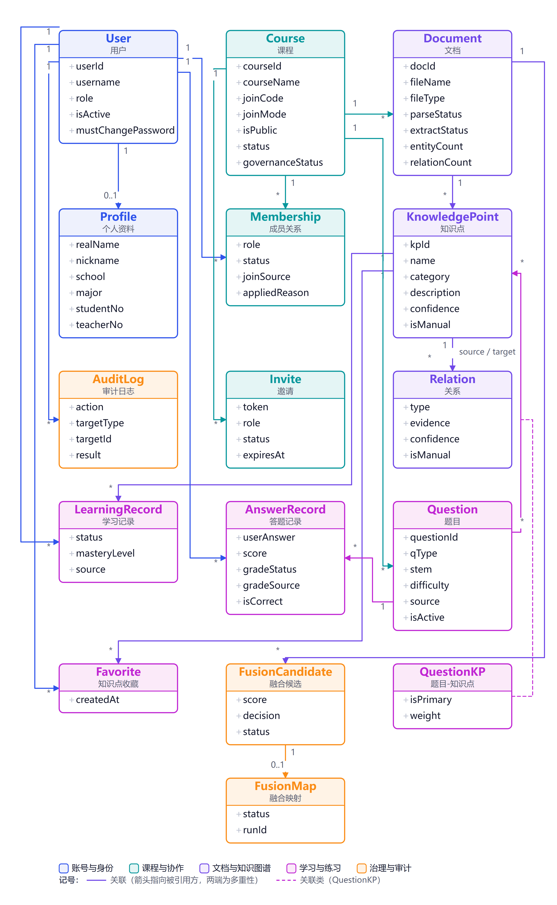

### 3.3 核心对象与关系

| 对象 | 业务定义 | 关键关系 | 生命周期/状态 | 所有者/维护者 |
|---|---|---|---|---|
| 用户 | 系统账号，角色为学生/教师/管理员 | 拥有个人资料；产生成员关系、学习记录、答题记录 | 启用/停用；首次登录需改密 | 本人；管理员可治理 |
| 个人资料 | 用户的展示与身份信息 | 1:1 用户 | 随用户存在 | 本人 |
| 课程 | 教学组织单元 | 1:N 成员、文档、题目；1:N 邀请 | `status` 0/1；治理 normal/hidden/archived | 创建者；管理员可治理 |
| 成员关系 | 用户在某课程中的角色与状态 | N:1 用户、课程 | pending/approved/rejected/removed | 课程创建者/协作教师 |
| 邀请 | 一次性加入链接 | N:1 课程 | active/used/revoked；过期按时间折算 | 课程教师 |
| 文档 | 课程资料与构建入口 | N:1 课程；1:N 知识点 | 解析四态 + 抽取四态 | 课程教师 |
| 知识点 | 图谱节点 | N:1 文档；N:M 关系、题目、学习记录、收藏 | 创建/编辑/删除；手工标记 | 课程教师；融合可折叠 |
| 关系 | 有向语义边 | N:1 源/目标知识点 | 创建/编辑/删除；融合硬负门 | 课程教师 |
| 学习记录 | 学生对知识点的状态与掌握度 | N:1 用户、课程、知识点 | MASTERED/LEARNING/RECOMMENDED | 学生；教师可查看进度 |
| 知识点收藏 | 学生收藏的知识点 | N:1 用户、知识点 | 添加/取消 | 学生 |
| 题目 | 课程题库中的题目 | N:1 课程；N:M 知识点 | 启用/停用/软删/物理删除 | 课程教师 |
| 题目-知识点 | 题目与知识点的关联 | N:M | 主知识点唯一 | 课程教师/自动标注 |
| 答题记录 | 学生对题目的作答与成绩 | N:1 用户、题目 | PENDING/GRADED；追加式 | 学生产生；教师批改 |
| 融合候选 | 同文档内可能同义的实体对 | N:1 文档 | PENDING/ACCEPTED/REJECTED/DEFERRED；decision SAME/DIFFERENT/UNCERTAIN | 管理员 |
| 融合映射 | 源→规范节点的折叠记录 | N:1 文档 | ACTIVE/REVOKED | 管理员 |
| 审计日志 | 管理员操作记录 | N:1 操作人 | 追加式；success/failure | 平台 |

### 3.4 数据字典

> 本表按**业务概念**描述，不写数据库表名与字段类型；实现载体见附录 D。隐私属性按“高敏感/可识别/行为数据/公开”标注；访问规则按角色与对象范围描述。

| 数据对象/字段组 | 业务含义 | 来源 | 关键约束 | 责任/维护 | 隐私属性 | 访问规则 |
|---|---|---|---|---|---|---|
| 账号 | 登录标识、角色、启用状态、强制改密标记、口令哈希 | 用户注册；管理员创建/重置 | 用户名唯一；角色仅为学生/教师/管理员；口令只存哈希；停用/注销不能登录 | 本人；管理员 | 高敏感（口令哈希）；可识别（用户名） | 本人可改密码/注销；管理员可查看列表、改角色、重置、启停；任何人不得读回口令 |
| 个人资料 | 昵称、真名、性别、学校、学院、专业、年级、班级、学号/工号、职称、研究方向、简介、头像 | 用户填写 | 仅本人可改；头像≤2MB 且扩展名白名单 | 本人 | 可识别（真名/学号/工号/头像）；一般（学校/专业等） | 本人可读写；课程教师可在成员列表看到课程成员资料；管理员可按治理需要查看；不向非成员公开 |
| 课程 | 课程名、课程代码、描述、组织、分类、封面、加课码、加入方式、公开性、业务状态、治理状态 | 教师创建/编辑；管理员治理 | 加课码唯一；加入方式三选一；治理状态三选一；可见性需三条件同时成立 | 创建者；管理员 | 一般（课程信息）；加课码为准入凭据 | 成员/管理者可读；公开课对学生可见元数据；加课码只对管理者返回；非成员教师不可读他人课程 |
| 成员关系 | 用户在课程中的角色、状态、加入来源、申请理由、审核意见、时间 | 创建/加课码/邀请/申请/导入 | 同一课程+用户唯一；状态四选一；创建者不可被拒绝/移除 | 课程创建者/协作教师 | 行为数据（加入/审核记录）；申请理由可能含个人信息 | 本人可看自己的状态/理由/意见；课程教师可看本课程成员；管理员可治理；非成员不可看成员列表 |
| 邀请 | 令牌、角色、状态、有效期、邀请人、使用者、使用时间 | 教师创建 | 令牌唯一；一次性；1–365 天；过期按时间折算 | 课程教师 | 高敏感（准入令牌） | 管理者可创建/撤销/查看；持链接者可预览/接受；不得公开传播 |
| 文档 | 文件名、类型、大小、哈希、存储路径、解析/抽取状态、错误信息、实体/关系计数、上传人 | 教师上传；系统解析/抽取 | 格式四选一；≤50MB；非空；路径只存服务端；状态机见 §5 | 课程教师 | 一般（课程资料）；路径不对外暴露 | 课程成员可读元数据/内容；管理者可上传/删除；非成员 403 |
| 知识点 | 名称、类别、描述、置信度、手工标记、所属课程/文档 | LLM 抽取；教师手工创建/编辑；融合保留 | 名称+课程+文档为 MERGE 键；kp_id 全局唯一；类别四选一 | 课程教师；融合管理员 | 一般（课程知识） | 课程成员可读；管理者可写；融合映射影响读图口径 |
| 关系 | 源、目标、类型、证据、置信度、手工标记、所属课程/文档 | LLM 抽取；教师手工创建/编辑 | 类型白名单；禁止自环；端点必须同文档；删除按 elementId | 课程教师 | 一般 | 课程成员可读；管理者可写 |
| 学习记录 | 用户、课程、文档、知识点、状态、掌握度、来源、时间 | 学生标记/取消；系统可写推荐状态 | 用户+课程+知识点唯一；状态三选一；掌握度 0–100 | 学生；教师可查看进度 | 行为数据（学习状态/掌握度） | 学生可读写本人；课程教师可看本课程成员进度；管理员看聚合统计 |
| 知识点收藏 | 用户、课程、文档、知识点、时间 | 学生添加 | 同一用户+知识点幂等 | 学生 | 行为数据 | 本人可读写；取消不需成员身份；教师不查看个人收藏明细 |
| 题目 | 题型、题干、选项、答案、解析、难度、来源、启停、导入批次/质量状态、创建人 | 教师手工创建；试题导入 | 题型五选一；难度 1–5；字段长度限制；答案必填；单题知识点≤10；有作答则软删 | 课程教师 | 一般（题目）；答案/解析为受控内容 | 教师可读写；学生只能通过练习接口读取脱敏视图；提交后才可看答案/解析 |
| 题目-知识点 | 题目与知识点的关联、主知识点、权重 | 教师挂载；自动标注 | 题目+知识点唯一；主知识点唯一；单题≤10 | 课程教师/自动标注 | 一般 | 教师可读写；学生不可直接管理；影响推荐与覆盖率 |
| 答题记录/成绩 | 作答内容、分数、是否正确、判分来源、批改状态、批改人、评语、时间 | 学生提交；教师批改 | 追加式；主观题 PENDING→GRADED；客观题直接 GRADED；正确率只算 GRADED | 学生产生；教师批改 | 高敏感（学习成绩/作答）；行为数据 | 学生可看本人；课程教师可看本课程待批/成绩；管理员可按治理/审计需要查看；不得向其他学生公开 |
| 题目收藏 | 用户、题目、时间 | 学生添加 | 幂等 | 学生 | 行为数据 | 本人可读写；教师不查看个人收藏明细 |
| 融合候选/映射/冲突/批次 | 候选分数、决策、状态、审核意见、源/目标、映射状态、批次配置快照、冲突类型 | 系统扫描/LLM 消歧；管理员审核/应用 | 候选按文档唯一；审核结论不被扫描覆盖；同一源 ACTIVE 唯一；映射只软撤销 | 管理员 | 一般（课程知识治理）；操作人可识别 | 仅管理员；跨文档/跨课程拒绝；课程教师不可直接操作融合 |
| 审计日志 | 操作人、动作、对象、结果、详情、时间、请求信息 | 管理员写操作自动记录 | 追加式；成功/失败均记录；dry-run 不记录；不含密码 | 平台 | 可识别（操作人/IP/UA）；行为数据 | 仅管理员可查；不得修改/删除 |
| 向量缓存 | 知识点/题目的向量文本、文本指纹、所属课程/文档 | 系统向量化 | 以 kp_id 集合+epoch 判新鲜度；失效粒度整文档 | 系统 | 由课程内容派生；无额外个人数据 | 不直接暴露给用户；仅检索服务内部使用 |
| 文件实体 | 原始课程文档、头像文件 | 教师/用户上传 | 存储路径不对外；文件名清洗；大小限制 | 上传者/系统 | 可能含课程内容；头像可识别 | 课程成员按文档权限读取；头像按资料可见范围 |

### 3.5 数据来源与质量属性

| 数据 | 来源性质 | 质量/可信度说明 | 处理规则 |
|---|---|---|---|
| 课程、成员、题目、作答、成绩 | 原始资料（用户/教师输入） | 由用户输入与业务规则约束；可能存在录入错误 | 以后端校验与唯一约束为准；教师可修正题目；成绩以教师批改为准 |
| 抽取的知识点/关系 | AI候选 | LLM 输出；受提示词、本体、温度、文档质量影响；置信度为模型自评 | 允许教师增删改；不得把 AI 输出直接表述为“教材事实”；评测指标见 §6 |
| 金标准 | 原始资料（人工标注） | 预测前冻结；用于评测，不进入生产图谱 | 评测脚本只读；不得用模型输出反向修改 gold |
| 自动标注的知识点 | AI候选 + 规则融合 | 字面/向量/图谱三层；弱标签评测有偏；graph_only 低置信 | 默认不写库；写库需 apply+阈值+课程清单+非 graph_only；教师可改 |
| 融合候选/映射 | AI候选 + 确定性评分 + 人工审核 | 分数不是概率；LLM 只在中档消歧；硬负门与手工保护 | 默认 dry-run；正式应用需 confirm；可撤销；审计保留 |
| 问答回答 | AI候选（基于课程上下文生成） | 受检索质量与 LLM 影响；可能拒答或表述不完整 | 必须返回 sources；无上下文应拒答；不得脱离课程知识编造 |
| 学习进度/掌握度 | 行为数据 + 自评 | 进度依赖图谱知识点总数；掌握度有自评与系统估计两套口径 | 明示口径；无证据时标注“证据不足”，不伪造 |
| 评测指标 | 原始资料（测试/评测报告） | 来自开发集、模拟数据或单次测量；不等于真实课堂效果 | 引用时注明数据规模、方法性质与局限；未验证项标待确认 |

### 3.6 数据生命周期与级联

**删除/停用原则：**

1. 能用“停用/软删”保护历史的，不物理删除；
2. 跨 SQLite 与 Neo4j 无事务，必须显式、按顺序清理；
3. 子表必须先于父表清理；删除失败要可重试/对账；
4. 删除课程/文档等高风险操作必须二次确认并审计。

| 操作 | 前置校验 | 级联范围（按顺序） | 结果 |
|---|---|---|---|
| 删除题目 | 课程教师；题目存在 | 答题记录 → 题目收藏 → 题目-知识点关联 → 题目 | 有作答：软删/停用并保留历史；无作答：物理删除 |
| 删除文档 | 课程教师；文档存在 | Neo4j 节点/关系 → 知识点向量 → 学习记录 → 知识点收藏 → 答题记录 → 题目收藏 → 该文档题目 → 融合数据（候选/映射/冲突/批次/范围）→ 本地文件 → 文档记录 | 返回各类删除计数；课程通用题（无 document_id）保留 |
| 删除课程 | 仅创建者；`confirm=true` | Neo4j 课程图 → SQLite 子表（文档、成员、邀请、向量、学习记录、收藏、题库、答题、融合等）→ 课程记录 | 不可恢复；返回统计；管理员删除课程同样需确认并审计 |
| 删除用户 | 管理员；不得删除自己/最后一名管理员 | 仅当无任何业务数据引用时物理删除；否则拒绝并引导禁用 | 有业务数据 → 2002；无业务数据 → 删除并审计 |
| 移除成员 | 课程教师；创建者不可移除 | 成员状态置 `removed`；保留学习记录/收藏/答题 | 学生可重新申请（按 BR-14）；重新加入不恢复旧状态 |
| 注销账号 | 本人校验密码 | 账号 `is_active=0`；不删除业务数据 | 管理员可重新启用；历史数据保留 |
| 撤销融合 | 管理员；`confirm=true` | 映射置 `REVOKED`；epoch+1；删除该文档向量 | 源节点恢复显示；历史映射保留 |

### 3.7 数据隔离与隐私

**隔离维度：**

| 维度 | 隔离规则 | 违反后果 |
|---|---|---|
| 课程 | 成员/管理者才能读课程内容；非成员只能读公开课元数据（仅学生） | 4003；文档内容 HTTP 403 |
| 文档 | 图谱、问答、路径、题目默认带 `document_id`；同课程不同文档同名节点独立 | 跨文档查询/写入拒绝或返回空 |
| 用户 | 学习记录、收藏、答题记录按 `user_id` 隔离；学生不能读他人明细 | 只返回本人数据；教师按课程范围读汇总/批改数据 |
| 角色 | 管理员端接口逐端点校验；管理员不是课程成员 | 非管理员 403；管理员不能以教师身份改题库/图谱/成绩 |
| 平台治理 | 下架/归档课程对非成员不可见、不可加入；邀请也拒绝 | 4003；发现页不显示 |

**隐私说明：**

- 口令只存 PBKDF2-SHA256 哈希（10 万次迭代，随机盐），任何接口不返回口令哈希；
- 审计日志记录操作人、动作、对象、结果、请求信息，不记录密码；
- 学习记录、答题记录、成绩属于学习行为数据，仅本人、课程教师、管理员按职责范围可见；
- 课程文档文本、问题、检索上下文会发送到外部 LLM/Embedding 服务；**不得上传含个人敏感信息的材料**；
- 备份文件包含业务数据与口令哈希，应按敏感数据保管；当前无自动备份调度与保留策略（见 §6.4）。

---

## 4. 规则与权限

### 4.1 业务规则

> 规则来源以代码与既有设计文档为主；标“待确认”的是产品取舍或实现不一致项。规则编号在 §7 追踪矩阵中引用。

#### 4.1.1 账户与认证

| 编号 | 规则 | 违反/边界处理 | 来源 |
|---|---|---|---|
| BR-01 | 自助注册仅允许 `student`/`teacher`；`admin` 只能由既有管理员指派 | 非法角色 1001 | 代码 |
| BR-02 | 用户名唯一；注册密码非空；修改密码至少 6 位且不得与原密码相同 | 1001/2002/2003 | 代码 |
| BR-03 | 登录签发 24 小时 JWT；停用/注销账号不能登录；服务端不维护 token 黑名单，登出仅清除客户端 token | 停用/注销 2004；token 过期需重新登录 | 代码/分析推导 |
| BR-04 | 引导账号不内置默认口令；未配置时随机生成并只在启动日志打印一次；首次登录强制改密 | 未改密不能进入业务页 | 代码 |
| BR-05 | 注销账号为停用（`is_active=0`），保留历史数据；管理员可重新启用 | 停用账号登录被拒 | 代码 |
| BR-06 | 个人资料仅本人可改；头像≤2MB 且扩展名白名单 | 超限/非法扩展名拒绝 | 代码 |

#### 4.1.2 课程与成员

| 编号 | 规则 | 违反/边界处理 | 来源 |
|---|---|---|---|
| BR-07 | 仅教师可创建课程；创建者自动成为已通过教师成员；默认 `join_mode=approval`、`is_public=1`、`status=1` | 非教师拒绝 | 代码 |
| BR-08 | 加课码唯一、8 位；只对课程管理者返回；刷新后旧码立即失效 | 旧码 4005 | 代码 |
| BR-09 | 课程对外可见必须同时满足：`is_public=1`、`status=1`、`governance_status=normal` | 任一不满足则不可发现/申请/加课码加入 | 代码 |
| BR-10 | 发现课程排除已是成员/待审核的课程；教师非成员不能读他人课程元数据（PUBLIC 仅对学生） | 4003 | 代码 |
| BR-11 | 加课码加入：学生+auto→approved；学生+approval→pending；closed→4006；教师一律 pending；被移除者→pending+apply；已通过/待审核→4004；课程不可见→4003；码无效→4005 | 按分支返回 | 代码 |
| BR-12 | 公开课申请仅对 `is_public=1` 且可见课程开放；始终 pending；理由≤200 字 | 非公开/不可见 4003 | 代码 |
| BR-13 | 邀请角色仅学生/教师；有效期 1–365 天（默认 7）；令牌一次性、原子消费；active 且未过期才可用；接受→approved；治理非 normal→4003；无效/已用/撤销/过期→4010；已是成员幂等且不消耗令牌。邀请路径**只受治理状态约束**：`status=0`（已关闭加课码/申请）的课程仍可凭邀请加入，这是 `join_mode=closed` 的既有设计 | 按分支返回 | 代码 |
| BR-14 | 被移除者经加课码/公开申请重新加入必须 pending；经邀请链接接受当前可直接 approved。两条路径是否应一致，**待确认** | 当前按实现执行 | 代码/待确认 |
| BR-15 | 创建者不可被拒绝/移除/退出；协作教师可被创建者移除，也可自行退出（接口允许，前端主要对学生开放）；学生可自行退出（removed）；移除/退出保留学习记录/收藏 | 4009/4003/2004 | 代码 |
| BR-16 | 删除课程仅创建者；必须 `confirm=true`；跨库级联；不可恢复 | 2008/4003 | 代码 |
| BR-17 | 治理 `hidden`/`archived` 不改业务 `status`；管理员“关闭”才改 `status=0`；治理非 normal 对外不可见/不可加入；`archived` 是否禁止教师编辑，**待确认** | 按管理端实现 | 代码/待确认 |
| BR-18 | 审核意见/申请理由≤200 字符 | 1001 | 代码 |

#### 4.1.3 文档与图谱

| 编号 | 规则 | 违反/边界处理 | 来源 |
|---|---|---|---|
| BR-19 | 上传仅课程管理者；支持 PDF/TXT/DOCX/MD；≤50MB；非空；文件名只取 basename；课程必须存在 | 1001/1002/1003/4003 | 代码 |
| BR-20 | 上传后同步执行解析、抽取、入图；解析状态 `UPLOADED→PARSING→PARSED/FAILED`；抽取状态 `PENDING→EXTRACTING→COMPLETED/FAILED`；失败保留记录与错误 | 失败返回 2005/3003 | 代码/设计 |
| BR-21 | 解析文本为空（如扫描版 PDF）→解析 `FAILED`、2005；抽取异常/结果 error→抽取 `FAILED`、3003 | 不进入后续步骤 | 代码 |
| BR-22 | 实体类别仅概念/定理/公式/方法；抽取无法归类→概念；手工新建非法→回退概念；手工编辑非法→拒绝 | 4001 | 代码 |
| BR-23 | 关系类型仅 `PRECEDES`/`CONTAINS`/`RELATED_TO`/`APPLIES_TO`；抽取非法→回退 `RELATED_TO`；手工非法→拒绝；禁止自环 | 4001 | 代码 |
| BR-24 | MERGE 键为 `(course_id, document_id, name)`；`kp_id` 全局唯一；同课程不同文档同名节点独立 | 不跨文档合并 | 代码/设计 |
| BR-25 | 图谱读需课程内容权限且 `document_id` 必填；节点上限 1–2000；按课程+文档隔离 | 4003/4001 | 代码 |
| BR-26 | 图谱写需课程管理权限；手工节点 `is_manual=1`；删除节点连带关系；关系删除按 `elementId` | 4003/4001 | 代码 |
| BR-27 | 删除文档需课程管理权限；级联顺序：图→向量→学习记录→收藏→答题→题目收藏→题目→融合→文件→文档；课程通用题保留 | 返回各类计数 | 代码 |
| BR-28 | 删除课程需创建者+确认；级联清 SQLite 子表与 Neo4j；不可恢复 | 2008/4003 | 代码 |

#### 4.1.4 智能问答

| 编号 | 规则 | 违反/边界处理 | 来源 |
|---|---|---|---|
| BR-29 | 指定课程时需内容权限；未指定课程时只查 `allowed_course_ids`；无可见课程不返回全库 | 4003/空结果 | 代码 |
| BR-30 | 向量优先；embedding 未配置/失败→关键词 `CONTAINS`；必须记录 warning，不得静默伪装为空知识库 | 降级日志 | 代码 |
| BR-31 | 索引新鲜度 = 文档当前 `kp_id` 集合 + 融合 epoch 与已存向量比对；不一致必须重建；不得“有向量就跳过” | 懒重建 | 代码 |
| BR-32 | 回答只能基于检索上下文；无相关内容应明确拒答；不得编造 | 提示词约束 | 代码/设计 |
| BR-33 | `sources` 必须等于本次喂给 LLM 的上下文；一次提问只检索一次 | 代码结构约束 | 代码 |
| BR-34 | 问答 LLM：temperature=0.3、max_tokens=1024、超时 15 秒；失败返回明确致歉文本 | 明确失败 | 代码 |
| BR-35 | 融合后问答与图谱一致：源节点折到规范节点；上下文显示“又称”；关键词命中源节点也折叠 | 读时折叠 | 代码 |

#### 4.1.5 学习记录与路径

| 编号 | 规则 | 违反/边界处理 | 来源 |
|---|---|---|---|
| BR-36 | 标记需内容权限+知识点存在；同一用户+课程+知识点唯一（upsert）；状态三选一；掌握度 0–100；来源 MANUAL | 4001/4002/4003 | 代码 |
| BR-37 | 文档进度 = 已掌握知识点数 / 文档知识点总数；总数为 0 → 0%；全课程进度按课程分组 | 只算本人 | 代码 |
| BR-38 | `A -[:PRECEDES]-> B` 表示 A 是 B 的前置；前置递归≤5；无 PRECEDES 时降级 CONTAINS 上层概念 | 返回“建议先了解” | 代码 |
| BR-39 | 下一步推荐：无掌握→根节点；有掌握→所有前置已掌握且未掌握的后继；按前置数降序；≤10；无候选→根节点排除已掌握 | 仅建议 | 代码 |
| BR-40 | 目标路径：根→目标 PRECEDES 路径≤10 条边、≤5 条；无路径→目标+RELATED_TO | 降级返回 | 代码 |
| BR-41 | 知识点收藏幂等；取消只删本人记录，不要求成员身份（用于清理个人数据） | 幂等 | 代码 |
| BR-42 | 移除成员保留学习记录/收藏；重新加入后可继续使用 | 不级联删除 | 代码 |

#### 4.1.6 题库、练习与批改

| 编号 | 规则 | 违反/边界处理 | 来源 |
|---|---|---|---|
| BR-43 | 题型五类；单选/多选/判断自动判分；填空/解答由教师批改 | 非法题型 1001 | 代码 |
| BR-44 | 题干/解析≤1000 字；难度 1–5；填空≤20 空；每空答案≤200 字；解答参考答案≤4000 字；单题知识点≤10；单选答案恰好 1 个 | 1001 | 代码 |
| BR-45 | 题目引用的 `kp_id` 必须存在于本课程图谱（图谱可用时）；否则 4002；图谱不可用时放行并标记 `kp_checked=false` | 4002 | 代码 |
| BR-46 | 学生视角不得返回答案/解析；只有提交后下发；主观题批改后才下发参考答案/解析 | 脱敏 | 代码 |
| BR-47 | 客观题判分：单选归一化严格相等；多选集合严格相等；判断布尔归一化；正确 100、错误 0 | 服务端判分 | 代码 |
| BR-48 | 主观题提交只落 `PENDING`；教师批改 0–100；≥60 记正确；`grade_source=TEACHER`；重批覆盖；正确率/错题本/统计只算 `GRADED` | 4001 | 代码 |
| BR-49 | 教师批改仅课程教师；按课程作用域；客观题不允许人工批改 | 4003/4001 | 代码 |
| BR-50 | 题目删除：有作答→软删/停用；无作答→物理删除；答题/收藏/知识点关联先清理 | 保留历史 | 代码 |
| BR-51 | 自动标注：字面 0.45/向量 0.45/图谱 0.10，按可用层加权平均；入候选≥0.30；graph_only≥0.01；写库≥0.60；high≥0.75、medium≥0.50；top-5 | 只给建议 | 代码 |
| BR-52 | 自动标注写库六闸门：apply=true；only_missing 默认 true；分数≥0.60；kp 在课程清单且非 graph_only；合并而非覆盖；单题≤10 | 不满足则跳过 | 代码 |
| BR-53 | 试题导入：确定性解析、不调用 LLM；质量状态 READY/NEEDS_REVIEW/ANSWER_MISSING；预览后提交；按题干去重；默认暂存 `is_active=0`，可激活；记录批次 | 解析失败提示 | 代码 |
| BR-54 | 推荐出题：score=0.30·need+0.20·due+0.15·diff_fit+0.10·novelty+0.10·wrong+0.05·importance+0.10·semantic；质量差×0.3；mixed 40/25/20/15；同 KP 上限 ceil(count/3)；默认排除主观题；seed 可复现 | 降级提示 | 代码 |
| BR-55 | 覆盖率 = 有≥1 道启用题的知识点数 / 文档（或课程）知识点总数；悬空 kp_id 单列；图谱不可用时降级 | 不报 500 | 代码 |
| BR-56 | 停用题目移出出题池；历史答题记录保留；统计口径按已批改记录 | 不可作答 2004 | 代码 |

#### 4.1.7 管理员与知识融合

| 编号 | 规则 | 违反/边界处理 | 来源 |
|---|---|---|---|
| BR-57 | 管理员端每个端点逐端点校验管理员；管理员不是课程成员，教学内容读取走管理员专用只读接口；不得以管理员身份执行教师教学写操作（题库/图谱编辑/批改） | 403/拒绝 | 代码/设计 |
| BR-58 | 管理员写操作必须审计（成功/失败）；dry-run 不写库不审计；审计不含密码；日志追加式 | 审计缺失视为缺陷 | 代码 |
| BR-59 | 课程治理：下架/恢复/归档/取消归档/关闭/重开/转移/删除；治理与业务状态正交；删除需确认；所有写操作审计 | 2008/4003 | 代码 |
| BR-60 | 融合严格文档级；候选/映射/冲突/批次都带 `(course_id, document_id)`；跨课程/跨文档拒绝 | 4003 | 代码 |
| BR-61 | 融合决策：≥0.86 且无硬负门→SAME（可自动）；0.62–0.86→LLM 消歧，LLM 不可用→UNCERTAIN（绝不 SAME）；0.45–0.62→人工候选；<0.45 不建候选；硬负门 `CONTAINS`/`PRECEDES`/`APPLIES_TO` 禁止自动 SAME；手工节点不得作为源 | 按档位执行 | 代码 |
| BR-62 | 融合 apply：默认 dry-run；正式需 confirm；单事务写 run/候选状态/映射/epoch/失效向量；不碰 Neo4j；默认应用 ACCEPTED + rule-SAME PENDING；显式 candidate_ids 可指定；同一源多目标只保留最高分并记冲突 | 1001/5002/5003 | 代码 |
| BR-63 | 融合撤销：映射置 REVOKED 不删行；epoch+1、失效向量；整批撤销更新 run 状态；审计保留 | 幂等 | 代码 |
| BR-64 | 融合读图：默认折叠 ACTIVE 映射；源节点仍在 Neo4j；管理员可看 raw/folded；概览同时给两种口径 | — | 代码 |

#### 4.1.8 一致性与通用规则

| 编号 | 规则 | 违反/边界处理 | 来源 |
|---|---|---|---|
| BR-65 | SQLite 与 Neo4j 无跨库事务；级联删除必须两侧显式清理；失败要可重试/对账 | 残留数据视为缺陷 | 代码/设计 |
| BR-66 | SQLite 使用 WAL；`busy_timeout=15s`；备份用 `backup_to()` 获取一致快照；当前无自动备份调度 | 备份缺口见 §6.4 | 代码/设计 |
| BR-67 | 唯一约束：成员（课程+用户）、学习记录（用户+课程+知识点）、题目-知识点（题目+知识点）、融合源 ACTIVE 唯一、邀请令牌唯一；重复操作应幂等或明确拒绝 | 唯一约束/4004 | 代码 |
| BR-68 | 列表接口必须有分页/上限：成员 100、题目 100、答题记录 500、图节点 2000、练习 50 | 超限截断/4001 | 代码 |

### 4.2 计算规则

| 编号 | 名称 | 公式/规则 | 说明 |
|---|---|---|---|
| CR-01 | 文档进度 | `mastered_count / total_nodes × 100%`；`total_nodes=0` 时 0% | 只统计本人；total 来自该文档图谱知识点数 |
| CR-02 | 正确率 | `已批改且正确记录数 / 已批改记录总数 × 100%` | `PENDING` 不计入分母；主观题批改后才纳入 |
| CR-03 | 知识点覆盖率 | `有≥1 道启用题的知识点数 / 知识点总数 × 100%`；只统计启用题；悬空 kp_id 单列 | 不是“题目覆盖率”；图谱不可用时降级 |
| CR-04 | 掌握度估计（推荐器） | 练习权重 `w=0.5^(Δdays/14)`；`acc=Σw·credit/Σw`，`credit=score/100`；自评 `MASTERED=1`、`LEARNING=0.5`、其他 0；两者都有时 `0.5·acc+0.5·自评`，否则取可用项；无证据用中性值 50 做难度适配 | 与学习记录中的自评 `mastery_level` 是两个口径，界面需区分 |
| CR-05 | 推荐分数 | `0.30·need + 0.20·due + 0.15·diff_fit + 0.10·novelty + 0.10·wrong + 0.05·importance + 0.10·semantic`；区分度差时乘 0.3 | `need=1-掌握度/100`；`due=min(天数/7,1)`；`target=1+4·掌握度/100`；`diff_fit=1-|难度-target|/4`；语义分数标准化 |
| CR-06 | 融合分数 | 可用层加权：词面 0.40、上下文 0.20、名称-描述 0.30、语义 0.10；乘类别因子（同 1.0/近 0.85/冲突 0.60）；子串上下位重罚 0.35、轻罚 0.75；显式等价/规范化同名有托底值 | 语义层不可用时该项权重按比例归零；阈值见 CR-07/BR-61 |
| CR-07 | 融合分档 | `≥0.86` SAME；`0.62–0.86` LLM 消歧；`0.45–0.62` 人工候选；`<0.45` 不建候选 | 硬负门优先于分数 |
| CR-08 | 路径优先级 | 候选的优先级 = 其前置知识数量；降序；最多 10 个 | 前置越多，越应优先安排 |
| CR-09 | 问答 top-k | 默认 5；余弦相似度排序；索引缓存 TTL 60 秒 | 未指定文档时向量不可用，走关键词 |
| CR-10 | mixed 配比 | weak 40%、review 25%、new 20%、advanced 15%；同一知识点题数上限 `ceil(count/3)` | 桶内不足自动回填 |
| CR-11 | 客观题得分 | 答案匹配则 100，否则 0 | 多选按集合严格相等；判断做布尔归一化 |
| CR-12 | 主观题得分 | 教师给 0–100；`is_correct = score ≥ 60` | 重批覆盖；统计只算 `GRADED` |
| CR-13 | 自动标注分数 | 可用层加权平均：字面 0.45、向量 0.45、图谱 0.10；缺失层不进分母 | 纯字面强命中也可达到写库阈值；graph_only 低置信 |
| CR-14 | 学习记录进度汇总 | 按 `(user_id, course_id, kp_id)` 唯一；状态取最新 upsert；掌握度取记录值 | 与推荐器估计分开 |

### 4.3 决策表

#### DT-01 加入课程决策

| 来源 | 账号角色 | 课程加入方式/状态 | 当前成员状态 | 结果 |
|---|---|---|---|---|
| 加课码 | 学生 | auto；课程可见 | 无记录 | approved |
| 加课码 | 学生 | approval；课程可见 | 无记录 | pending |
| 加课码 | 学生 | closed；课程可见 | 无记录 | 4006 拒绝 |
| 加课码 | 教师 | 任意；课程可见 | 无记录 | pending（协作教师需审核） |
| 加课码 | 任意 | 任意 | removed | pending + join_source=apply |
| 加课码 | 任意 | 任意 | approved/pending | 4004 拒绝 |
| 加课码 | 任意 | 课程不可见（status=0 或治理异常） | 任意 | 4003 |
| 公开申请 | 学生/教师 | `is_public=1` 且可见 | 无记录/rejected/removed | pending |
| 公开申请 | 任意 | 非公开/不可见 | 任意 | 4003 |
| 邀请 | 任意 | 治理 normal；`status=1` 或 `0` 均可 | 无记录/rejected/removed | approved（一次性令牌） |
| 邀请 | 任意 | 治理 normal | approved | approved（幂等，不消耗令牌） |
| 邀请 | 任意 | 治理非 normal | 任意 | 4003 |
| 邀请 | 任意 | 任意 | 令牌 used/revoked/expired | 4010 |

> 注：邀请路径对被移除者的处理与加课码/申请路径不一致，见 BR-14 与 §8.2。

#### DT-02 判分与答案可见性决策

| 题型 | 提交动作 | 判分状态 | 分数/对错 | 答案/解析可见性 |
|---|---|---|---|---|
| 单选 SINGLE | 学生提交 | GRADED（AUTO） | 正确 100，错误 0 | 提交后可见 |
| 多选 MULTI | 学生提交 | GRADED（AUTO） | 集合完全相等 100，否则 0 | 提交后可见 |
| 判断 JUDGE | 学生提交 | GRADED（AUTO） | 布尔归一化后相等 100，否则 0 | 提交后可见 |
| 填空 FILL | 学生提交 | PENDING | 不显示分数/对错 | 批改后才可见参考答案/解析 |
| 解答 ESSAY | 学生提交 | PENDING | 不显示分数/对错 | 批改后才可见参考答案/解析 |
| 填空/解答 | 教师批改 | GRADED（TEACHER） | 0–100；≥60 正确 | 学生可见分数/评语/答案/解析 |
| 任意主观题 | 教师重批 | GRADED（TEACHER） | 覆盖旧分数/评语 | 覆盖后可见 |
| 客观题 | 教师尝试人工批改 | 拒绝 | — | — |

#### DT-03 自动标注写库决策

| apply | only_missing | 分数≥0.60 | kp 在课程清单 | graph_only | 结果 |
|---|---|---|---|---|---|
| false | 任意 | 任意 | 任意 | 任意 | 只返回候选，不写库 |
| true | true | 是 | 是 | 否 | 写入（仅未挂知识点的题） |
| true | false | 是 | 是 | 否 | 写入（可补已有题） |
| true | 任意 | 否 | 任意 | 任意 | 跳过 |
| true | 任意 | 任意 | 否 | 任意 | 跳过 |
| true | 任意 | 任意 | 任意 | 是 | 跳过（低置信建议） |
| true | 任意 | 是 | 是 | 否 | 单题已满 10 个知识点时跳过多余项 |

#### DT-04 融合决策

| 分数档 | 硬负门 | 源为手工节点 | LLM 可用 | 决策/状态 |
|---|---|---|---|---|
| ≥0.86 | 否 | 否 | 任意 | SAME（可自动应用；仍需管理员确认正式写库） |
| ≥0.86 | 是 | 任意 | 任意 | 不自动 SAME；落候选/人工判断 |
| 0.62–0.86 | 否 | 否 | 是 | LLM 消歧：SAME/DIFFERENT/UNCERTAIN |
| 0.62–0.86 | 否 | 否 | 否 | UNCERTAIN（绝不 SAME） |
| 0.45–0.62 | 任意 | 任意 | 任意 | 人工候选 |
| <0.45 | 任意 | 任意 | 任意 | 不建候选 |
| 任意 | 任意 | 是 | 任意 | 不得作为被折掉的源 |

### 4.4 权限矩阵

> 行是角色/课程关系，列是对象与操作。**“是/否/只读/范围”同时说明对象范围**；不要只看角色名。

| 角色/关系 | 课程元数据 | 课程内容（文档/图谱/问答/路径/收藏/练习） | 课程管理（设置/上传/删文档/改图/成员/邀请/加课码） | 删除课程 | 题库管理（出题/统计/覆盖/标注/导入） | 本人学习数据 | 全课程学习数据（监测/批改） | 平台治理/用户/资源/审计/融合 | 个人资料 |
|---|---|---|---|---|---|---|---|---|---|
| 游客 | 否 | 否 | 否 | 否 | 否 | 否 | 否 | 否 | 否（仅登录/注册） |
| 学生（公开课非成员） | 是（仅公开+可见课程） | 否 | 否 | 否 | 否 | 否 | 否 | 否 | 是（本人） |
| 学生（pending） | 是（仅自己的申请状态+课程基本信息） | 否 | 否 | 否 | 否 | 否 | 否 | 否 | 是（本人） |
| 学生（rejected/removed） | 是（仅自己的状态） | 否 | 否 | 否 | 否 | 否 | 否 | 否 | 是（本人） |
| 学生（approved） | 是（本课程） | 是（本课程+文档范围） | 否 | 否 | 否 | 是（本人记录/作答/收藏） | 否（仅本人统计） | 否 | 是（本人） |
| 课程创建者 | 是（本课程） | 是（本课程+文档范围） | 是（本课程） | 是（confirm） | 是（本课程） | 是（如使用学习功能） | 是（本课程成员/批改） | 否 | 是（本人） |
| 协作教师（approved） | 是（本课程） | 是（本课程+文档范围） | 是（本课程） | 否（仅创建者） | 是（本课程） | 是（如使用学习功能） | 是（本课程成员/批改） | 否 | 是（本人） |
| 平台管理员 | 是（管理端视图） | 只读（管理端图谱/资源；不参与教学写入） | 平台治理（下架/归档/关闭/转移/删除资源），不是教师内容管理 | 是（需确认+审计） | 否（仅统计查看） | 不适用 | 只读统计（管理端） | 是 | 是（本人） |

**对象范围补充：**

| 对象 | 范围规则 |
|---|---|
| 课程 | 成员/管理者按 `course_id`；公开课元数据仅对 non-member 学生；教师非成员不可见他人课程 |
| 文档 | 必须属于课程；内容接口按 `doc_id → course_id → 成员关系` 判定；非成员 403 |
| 知识点/关系 | 必须属于 `(course_id, document_id)`；学习记录、题目挂载、路径查询均校验 |
| 题目 | 课程范围或课程+文档范围；课程通用题 `document_id` 为空；学生只能通过练习接口读脱敏视图 |
| 学习/答题数据 | 学生只看本人；课程教师看本课程汇总/待批/成绩；管理员按治理/审计需要看 |
| 融合 | 仅管理员；严格单文档；跨文档/跨课程拒绝 |
| 审计 | 仅管理员；追加式；不可修改/删除 |

### 4.5 错误与拒绝约定

| 码段/示例 | 含义 | 处理约定 |
|---|---|---|
| 0 | 成功 | 返回 `{code:0, message:"success", data}` |
| 1001 | 参数错误/非法动作/缺少确认 | 明确说明字段或缺失的确认参数 |
| 1002/1003 | 文件过大/文件为空 | 上传前/上传时拒绝 |
| 2001/2002/2003/2004 | 资源不存在/题目或用户不存在/文件不存在/成员记录不存在或账号已注销等 | 具体以 message 为准；文档内容接口映射 HTTP 404 |
| 2005 | 文档解析失败（含解析为空） | 文档记录保留，状态 FAILED |
| 3003 | 知识抽取失败 | 文档记录保留，状态 FAILED |
| 4001 | 业务参数非法（如掌握度越界、课程/文档 id 非整数） | 不写库 |
| 4002 | 知识点不存在/无效 | 题目挂载、学习标记等拒绝 |
| 4003 | 无权限/跨课程/跨文档 | 文档内容接口映射 HTTP 403 |
| 4004 | 已是成员/申请审核中/重复操作 | 幂等或明确拒绝 |
| 4005 | 加课码无效 | 提示确认后重试 |
| 4006 | 课程关闭加入 | 引导联系教师获取邀请 |
| 2008 | 删除课程/移除成员需二次确认 | 要求 `confirm=true` |
| 4009 | 创建者受保护（不可拒绝/移除） | 引导使用转让或课程删除 |
| 4010 | 邀请无效/已用/撤销/过期 | 重新生成邀请 |
| 5001 | 文件存储失败 | 检查磁盘/权限；清理孤儿记录 |
| 5002 | 图库不可用/读取失败 | 明确提示；不伪造空图 |
| 5003 | 融合事务失败（已回滚） | 可重试；不留半状态 |

> 多数业务错误以 HTTP 200 + 业务 `code` 返回；文档内容接口因是二进制流，额外把 2001/2002/2003 映射为 HTTP 404、4003 映射为 HTTP 403。前端不得只看 HTTP 状态判断业务结果。

### 4.6 人工确认点

以下操作必须由人明确确认，不能由 AI 或后台自动完成：

1. 删除课程、删除文档、移除成员；
2. 正式应用知识融合（即使是自动 SAME 候选）；
3. 主观题给分与评语；
4. 管理员删除用户/课程、修改角色、重置密码；
5. 自动标注写入题库（默认只给建议）；
6. 将 AI 抽取结果视为最终教学事实（教师应抽查/修正）；
7. 把评测数据/模拟数据表述为真实课堂效果（需在交付说明中标注）。

---

## 5. 行为与状态

### 5.1 核心业务过程活动图

#### 5.1.1 文档上传与知识构建

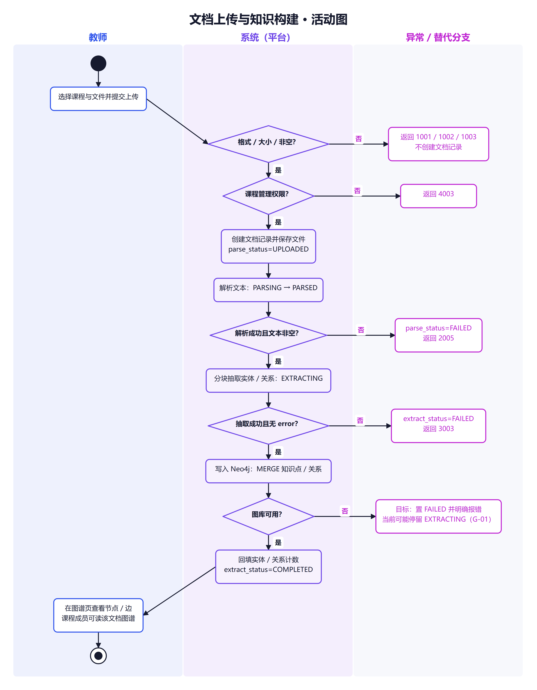

#### 5.1.2 RAG 问答

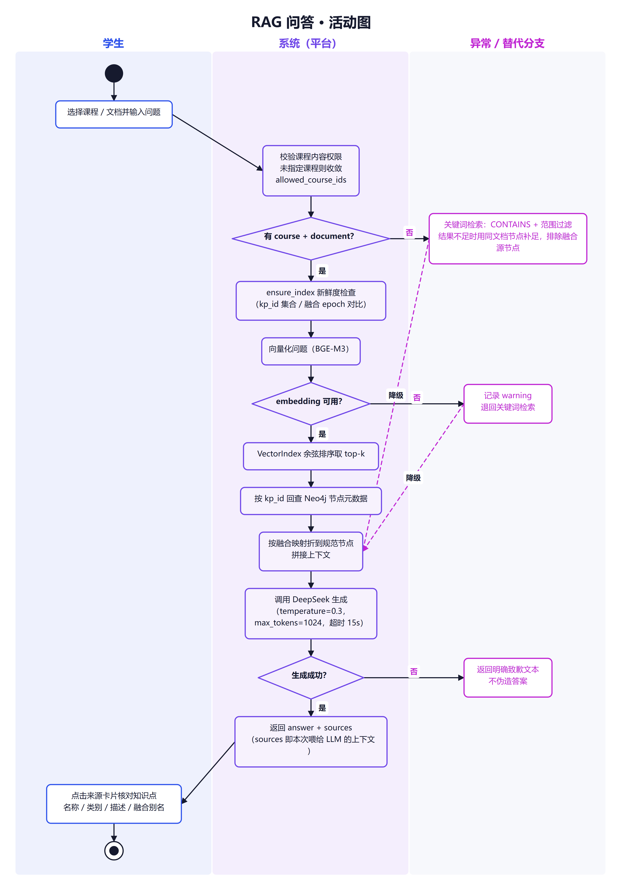

> 说明：Neo4j 在元数据回查阶段失败时，当前代码未统一捕获；目标行为应是明确报错或降级为关键词，而不是 500（见 §5.4 缺口 G-02）。

#### 5.1.3 练习与批改

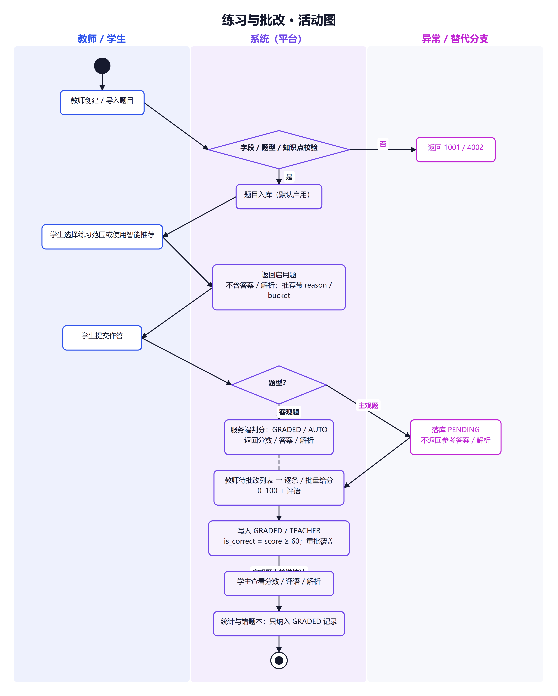

#### 5.1.4 文档级知识融合

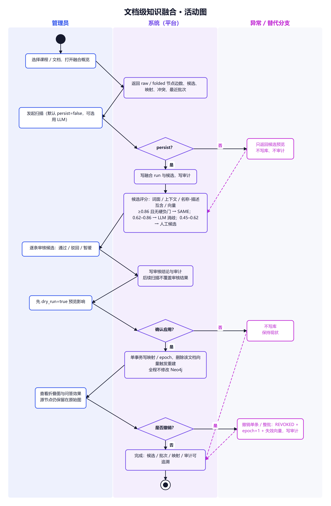

### 5.2 对象生命周期状态图

#### 5.2.1 文档解析与抽取

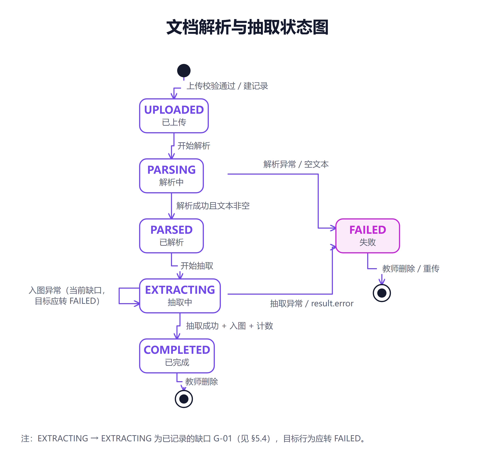

#### 5.2.2 课程成员

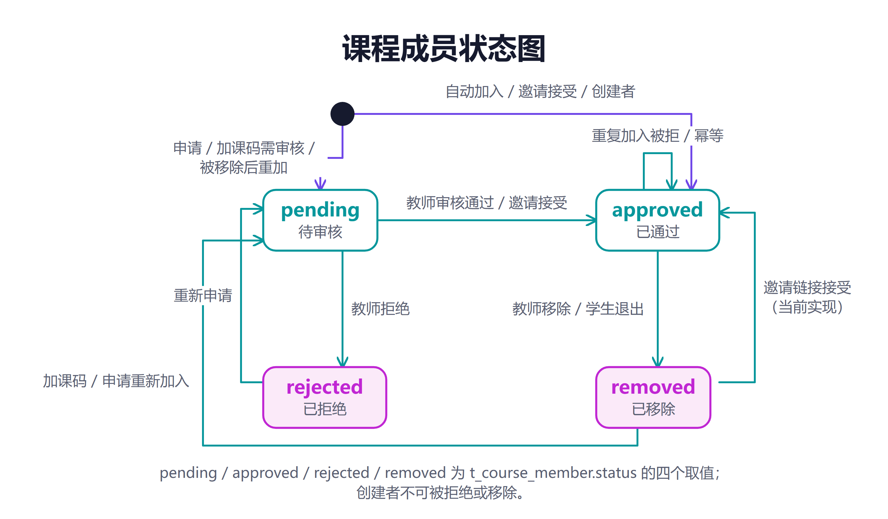

#### 5.2.3 邀请

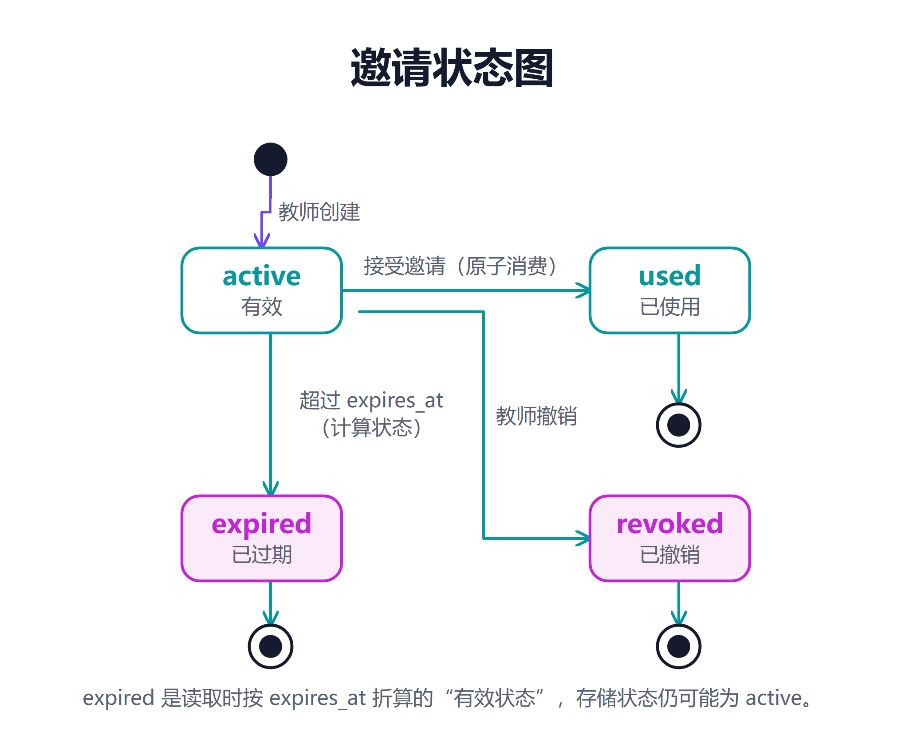

> `expired` 是读取时按 `expires_at` 折算的“有效状态”，存储状态仍可能为 `active`。

#### 5.2.4 答题与批改

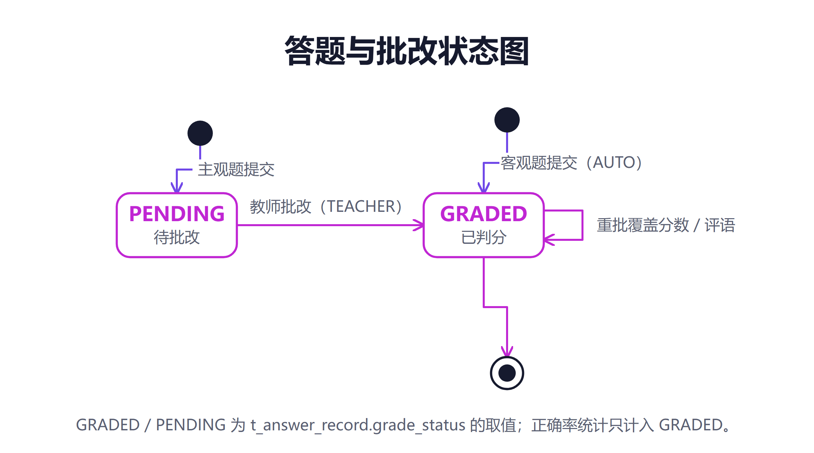

#### 5.2.5 融合批次/候选/映射

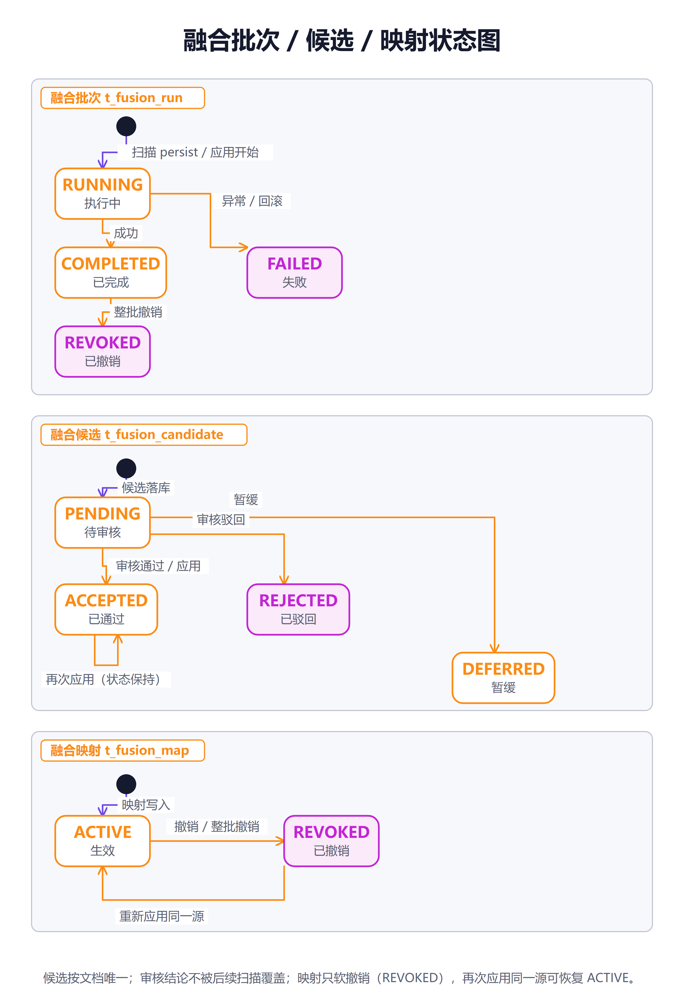

#### 5.2.6 课程治理与业务状态

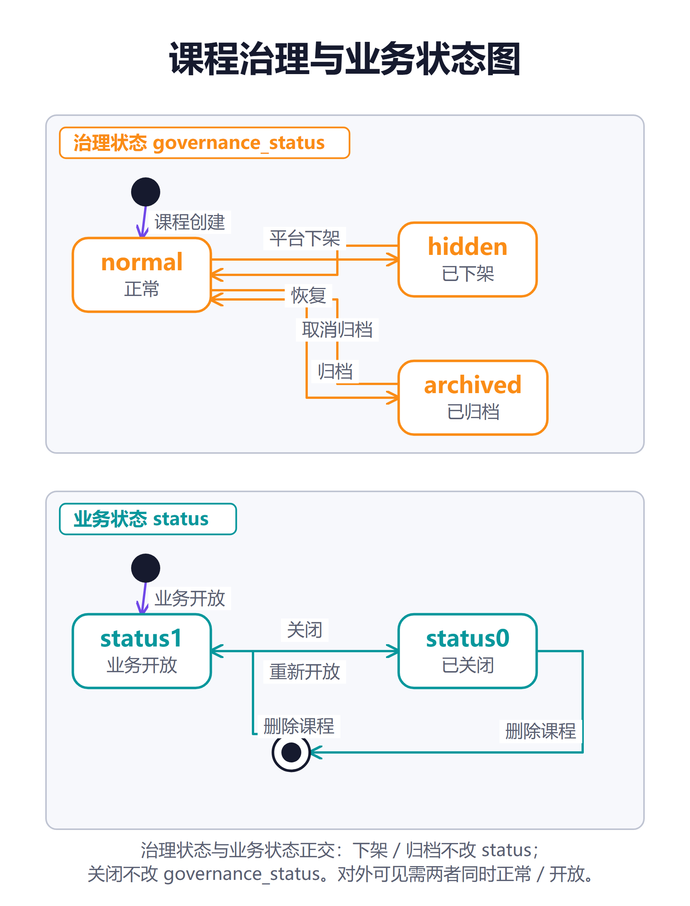

> 治理状态与业务状态正交：下架/归档不改 `status`；关闭不改 `governance_status`。对外可见需两者同时正常/开放。

### 5.3 状态转换表

| 编号 | 对象 | 当前状态 | 触发 | 角色/条件 | 目标状态/输出 | 失败处理 |
|---|---|---|---|---|---|---|
| ST-01 | 文档 | 无 | 上传校验通过 | 课程管理者 | UPLOADED + 记录 | 格式/大小/空文件不建记录 |
| ST-02 | 文档 | UPLOADED | 开始解析 | 系统 | PARSING | 解析异常 → FAILED |
| ST-03 | 文档 | PARSING | 解析成功且非空 | 系统 | PARSED | 空文本 → FAILED/2005 |
| ST-04 | 文档 | PARSING | 解析异常/空文本 | 系统 | FAILED + error_message | 返回 2005 |
| ST-05 | 文档 | PARSED | 开始抽取 | 系统 | EXTRACTING | — |
| ST-06 | 文档 | EXTRACTING | 抽取成功+入图+计数 | 系统 | COMPLETED + counts | 入图异常见 ST-08 |
| ST-07 | 文档 | EXTRACTING | 抽取异常/result.error | 系统 | FAILED + error_message | 返回 3003 |
| ST-08 | 文档 | EXTRACTING | Neo4j 入图异常 | 系统 | 目标 FAILED；当前可能停留 EXTRACTING | 当前缺口 G-01，需修复 |
| ST-09 | 成员 | 无 | 学生+auto+加课码 | 学生/课程可见 | approved | — |
| ST-10 | 成员 | 无 | 学生+approval/教师+加课码/公开申请 | 对应角色 | pending | 重复 → 4004 |
| ST-11 | 成员 | pending | 教师审核通过/邀请接受 | 课程教师/受邀者 | approved | — |
| ST-12 | 成员 | pending | 教师拒绝 | 课程教师 | rejected | 创建者不可拒绝 4009 |
| ST-13 | 成员 | approved | 教师移除/学生退出 | 课程教师/本人 | removed | 创建者不可移除 4009 |
| ST-14 | 成员 | rejected | 重新申请 | 学生/教师 | pending | — |
| ST-15 | 成员 | removed | 加课码/申请重新加入 | 对应角色 | pending + apply | — |
| ST-16 | 成员 | removed | 接受邀请 | 受邀者 | approved | 治理异常 4003 |
| ST-17 | 邀请 | active | 接受邀请 | 受邀者，令牌有效 | used + 成员 approved | 原子消费失败 4010 |
| ST-18 | 邀请 | active | 教师撤销 | 课程教师 | revoked | — |
| ST-19 | 邀请 | active | 超过 expires_at | 时间 | effective expired（存储仍 active） | 接受返回 4010 |
| ST-20 | 答题 | 无 | 客观题提交 | 学生 | GRADED/AUTO | 题目停用 2004 |
| ST-21 | 答题 | 无 | 主观题提交 | 学生 | PENDING | 不返回答案/解析 |
| ST-22 | 答题 | PENDING | 教师批改 | 课程教师 | GRADED/TEACHER | 分数越界 4001 |
| ST-23 | 答题 | GRADED | 教师重批 | 课程教师 | GRADED（分数/评语更新） | 覆盖旧值 |
| ST-24 | 融合批次 | 无 | 扫描 persist/应用开始 | 管理员 | RUNNING | — |
| ST-25 | 融合批次 | RUNNING | 成功 | 系统 | COMPLETED | — |
| ST-26 | 融合批次 | RUNNING | 异常/回滚 | 系统 | FAILED | 返回 5003；不留半状态 |
| ST-27 | 融合批次 | COMPLETED | 整批撤销 | 管理员+确认 | REVOKED | — |
| ST-28 | 融合候选 | 无 | 扫描 persist=true | 系统 | PENDING | 分数<0.45 不建 |
| ST-29 | 融合候选 | PENDING | 审核通过/驳回/暂缓 | 管理员 | ACCEPTED/REJECTED/DEFERRED | 审核结论不被扫描覆盖 |
| ST-30 | 融合候选 | PENDING + SAME | 正式应用 | 管理员+确认 | ACCEPTED | — |
| ST-31 | 融合映射 | 无 | 正式应用 | 管理员+确认 | ACTIVE | 事务失败回滚 5003 |
| ST-32 | 融合映射 | ACTIVE | 撤销/整批撤销 | 管理员+确认 | REVOKED | 幂等 |
| ST-33 | 融合映射 | REVOKED | 重新应用同一源 | 管理员+确认 | ACTIVE | 按实现恢复 |
| ST-34 | 课程治理 | normal | 下架 | 管理员 | hidden | 审计 |
| ST-35 | 课程治理 | hidden | 恢复 | 管理员 | normal | 审计 |
| ST-36 | 课程治理 | normal/hidden | 归档 | 管理员 | archived | 审计 |
| ST-37 | 课程治理 | archived | 取消归档 | 管理员 | normal | 审计 |
| ST-38 | 课程业务 | status=1 | 关闭 | 管理员/教师 | status=0 | 审计（管理员） |
| ST-39 | 课程业务 | status=0 | 重新开放 | 管理员/教师 | status=1 | — |
| ST-40 | 课程 | 任意 | 删除课程 | 创建者/管理员+确认 | 删除（级联） | 失败需对账/重试 |

### 5.4 异常与降级处置

| 编号 | 场景 | 当前行为 | 目标行为/风险 | 状态 |
|---|---|---|---|---|
| G-01 | Neo4j 在文档入图阶段不可用 | `build_graph` 异常向上抛出，文档可能停留在 `EXTRACTING`，API 返回 500 | 应捕获异常，置 `extract_status=FAILED`、写 error_message；清理/标记半成品节点；允许删除重传 | **缺口，需修复** |
| G-02 | Neo4j 在问答元数据回查阶段不可用 | `_vector_search`/关键词检索的 `db.query` 未统一捕获，可能 500 | 应明确返回“图库不可用”或降级为无来源的明确失败；不得伪造答案 | **缺口，需修复** |
| G-03 | 文件保存失败 | 文档记录已创建但文件不存在，返回 5001 | 应回滚/删除文档记录，或标记失败并提供清理入口 | **缺口，需修复** |
| G-04 | embedding 未配置/失败 | 记录 warning，退回关键词检索 | 可接受；但断网演示时表现为“回答变差却不报错”，需在 UI/日志提示降级 | 已实现，可观测性待增强 |
| G-05 | LLM 抽取超时/限流 | 抽取置 FAILED，返回 3003 | 可接受；建议提供失败重试入口（当前需删除重传） | 已实现，重试体验待改进 |
| G-06 | LLM 问答失败 | 返回“抱歉，问答服务暂时不可用” | 可接受；不得返回编造答案 | 已实现 |
| G-07 | 融合 LLM 不可用 | 0.62–0.86 档落 `UNCERTAIN`，绝不 SAME | 可接受；人工审核仍可推进 | 已实现 |
| G-08 | 融合事务中途失败 | 整体回滚，返回 5003 | 可接受；需确保审计不记录失败写操作（或记录失败结果） | 已实现 |
| G-09 | 图库不可用时成员进度 | 知识点总数退化为 0，进度 0，不崩 | 可接受；页面应标注“图库不可用/进度不可用” | 已实现 |
| G-10 | 管理员端图库不可用 | 概览返回 `graph_available=false`；读图 5002 | 可接受；不得伪造节点数 | 已实现 |
| G-11 | 并发重复加入/邀请 | 唯一约束/原子消费，重复返回 4004/4010 | 可接受 | 已实现 |
| G-12 | 跨库级联删除中途失败 | 可能出现一侧残留 | 需要重试/对账工具；当前无自动补偿 | **缺口，需改进** |
| G-13 | 断网/换机器后图谱为空 | AI 只回答“知识库没有相关内容”，不报错 | 部署文档必须明确“Neo4j 不随仓库走”；系统状态页应提示 | 已知部署陷阱 |
| G-14 | 同步上传/抽取阻塞事件循环 | 上传端点内同步执行解析/抽取/入图 | 目标迁移到后台任务/线程池；当前已知债务 | **架构缺口** |

### 5.5 并发、幂等与一致性

| 对象/操作 | 并发/重复风险 | 机制 | 结果 |
|---|---|---|---|
| 邀请接受 | 同一令牌被并发使用 | `mark_invite_used` 原子更新，rowcount=1 才通过 | 只有一个成功；其余 4010 |
| 成员加入 | 重复申请/重复加课 | `(course_id,user_id)` 唯一 + 状态守卫 | 4004 或幂等 |
| 学习标记 | 同一知识点重复标记 | `(user_id,course_id,kp_id)` 唯一 + upsert | 覆盖为最新状态 |
| 收藏 | 重复添加/取消 | 幂等写入/删除 | 无重复行 |
| 题目作答 | 同一题多次提交 | 追加式记录，不覆盖历史 | 保留每次作答 |
| 教师批改 | 重复批改 | 就地更新，重批覆盖 | 最新分数/评语生效 |
| 融合应用 | 同一源重复 apply | 事务 + ACTIVE 唯一 + WHERE REVOKED | 幂等；冲突记录 |
| 融合撤销 | 重复撤销 | 只更新 ACTIVE 行 | 幂等 |
| 向量索引 | 多进程缓存不一致 | 进程内缓存 + TTL 60s；写侧 invalidate | 其他 worker 最多 60s 后收敛 |
| 跨库删除 | 两侧无事务 | 显式顺序 + 失败重试/对账 | 当前无自动补偿，需人工/脚本核对 |

---

## 6. 质量要求

### 6.1 质量场景与指标

> 下表的“依据/状态”说明指标来自哪里、是否已验证。没有可靠数据的指标标“待确认”，不填猜测值。

| 编号 | 使用情境 | 可观察指标/目标 | 检验方法 | 依据/状态 |
|---|---|---|---|---|
| NFR-01 | 教师上传一章课程文档并等待构建 | 单文档上传→解析→抽取→入图 ≤60 秒 | 计时上传固定章节，记录 parse/extract 耗时；重复多次取中位数 | 计划书目标；记录约 41 秒（单次）；部分验证，待复测 |
| NFR-02 | 学生提问 | 单次问答 ≤15 秒或明确失败；不无限等待 | 以 `QA_TIMEOUT=15` 为上限；`test_qa_timing.py`/`test_perf_timing.py` 可测；P95 待实测 | 代码/脚本；部分验证 |
| NFR-03 | 向量检索 | N=1,000 条约 0.161ms；N=5,000 条约 0.42ms；缓存 TTL 60s；无 numpy 时回退纯 Python | `test_vector_index.py`、`eval_ann_compare.py`；微基准 | 代码注释/评测数据；已验证（微基准） |
| NFR-04 | 图谱查询 | 单次最多 2,000 节点（默认 500）；不返回全库 | 带 `limit` 的接口测试；超限 4001 | 代码；已实现 |
| NFR-05 | 大文件上传 | 超过 50MB 拒绝；空文件拒绝 | 上传边界测试 | 代码；已实现 |
| NFR-06 | 知识抽取质量 | 关系 F1 ≥0.70 | 四章 gold 评测，3 轮，temperature=0.3，chunk 6000/overlap 400 | 评测报告：0.8663/0.9079/0.8785/0.9153，均值 0.8920；已验证（开发集，本体约束） |
| NFR-07 | 问答质量 | 课内回答正确率≥95%；边界拒答 100%；top-3 召回≥90% | 固定 21 题测试集，逐题人工核对 | 报告：20/20、1/1、19/20（95%）、18/20（90%）；已验证 |
| NFR-08 | 自动标注质量 | hit@1、MRR 提升；写库误标可控 | 用已挂 kp_id 的题作弱标签，隐藏后预测 top-k | hit@1 0.4667→0.7000；MRR 0.6549→0.7883；hit@5 0.9917→0.9083；已验证（弱标签，口径有偏） |
| NFR-09 | 推荐出题质量 | 相比随机基线提升 HitRate/Coverage/NDCG | 课程 65、5 名学生、120 题、N=5、随机基线 30 次平均 | mixed vs random：HitRate@5 0.120 vs 0.095；Coverage@5 0.600 vs 0.387；NDCG@5 0.1555 vs 0.1069；初步验证（小规模模拟） |
| NFR-10 | LLM 依赖失败 | 抽取失败明确 3003；问答失败明确致歉；不得静默产出 0 知识点 | 断网/错误 key/超时注入测试 | 代码；已实现 |
| NFR-11 | Embedding 依赖失败 | 退回关键词并记录 warning；不得伪装为“知识库为空” | 移除 key/错误 base_url 测试 | 代码；已实现；UI 降级提示待增强 |
| NFR-12 | Neo4j 依赖失败 | 读图明确 5002；管理端统计可降级；文档构建/问答不得卡死 | 停 Neo4j 后测图/问答/构建/成员进度 | 部分实现；G-01/G-02 缺口 |
| NFR-13 | 数据一致性 | 删除课程/文档后无孤儿；关键唯一约束生效；WAL 可并发读 | `test_delete_document.py`、`test_sqlite_wal.py`、`test_fusion_course_delete.py`、计数核对 | 代码/脚本；待验证（本次未重跑） |
| NFR-14 | 账号安全 | 口令 PBKDF2-SHA256（10 万次、随机盐）；JWT HS256 24h；任何接口不返回口令哈希 | 代码审查；登录/改密测试 | 代码；已实现 |
| NFR-15 | 权限边界 | 课程内容/管理/删除分级；管理员逐端点校验；跨课程/跨文档拒绝 | `test_permission_matrix.py`、`test_graph_permission.py`、`test_course_member_flow.py`、`test_fusion_api_guard.py` | 代码/脚本；待验证（本次未重跑） |
| NFR-16 | 审计 | 管理员写操作成功/失败均记录；dry-run 不记录；不含密码 | 代码审查；管理端操作后查审计 | 代码；已实现；覆盖面待核对 |
| NFR-17 | 安全缺口 | 无限流/锁定；token 存客户端；HTTPS 部署未强制；无密码策略复杂度 | 渗透/配置审查 | **已知缺口，待确认/待改进** |
| NFR-18 | 隐私 | 学生只能看本人学习/答题；教师按课程范围；管理员按治理范围；外部 AI 不接收敏感个人信息 | 权限测试；数据流审查 | 部分实现；外部 AI 数据流需在部署说明中明示 |
| NFR-19 | 可用性 | 图谱缩放/拖拽/点击可用；阅读器可打开 PDF/TXT/MD/DOCX；错误提示可理解 | 浏览器走查/Playwright | 部分验证；本次未做浏览器走查 |
| NFR-20 | 兼容性 | 现代 Chromium（Chrome/Edge）可用；其他浏览器/移动端未保证 | Playwright chromium + 手工抽查 | 部分验证；其他环境待确认 |
| NFR-21 | 可维护性 | 新代码应通过相关 `test_*.py`；文档与代码一致；无静态检查/CI 是已知风险 | 代码审查；运行测试脚本 | 部分实现；无 lint/CI |
| NFR-22 | 可观测性 | 降级有 warning；LLM 调用有指标；管理端有系统状态；无集中日志/告警 | 日志检查；管理端系统状态页 | 部分实现 |
| NFR-23 | 备份恢复 | 可生成一致快照；有恢复演练；备份含敏感数据需保护 | `backup_to()`；手工恢复演练 | 部分实现；无自动调度/保留策略 |
| NFR-24 | 容量 | 当前单文档最大约 69 条向量；设计阈值 1,000 条/文档；numpy ≤5,000 条；>10,000 未上 ANN | `eval_ann_compare.py`；压测 | 微基准已验证；业务容量待确认 |
| NFR-25 | 部署 | 普通 PC 可启动后端+前端；Neo4j 与密钥需自备；无一键/容器流水线 | 按 README/使用说明部署 | 部分验证；部署自动化待确认 |

### 6.2 指标依据汇总

| 指标 | 数据规模/方法 | 关键局限 | 证据 |
|---|---|---|---|
| 抽取 F1 | 4 章、105,578 字符、189 gold 实体、214 gold 关系、3 轮、temperature=0.3、本体约束 | 高分部分依赖注入的领域本体；跨领域/封存集未验证；金标准为单标注者为主 | `知识抽取准确率测试报告.md`、`backend/eval_data/` |
| 问答 | 21 题、课程 5、Python OOP、69 节点/118 关系 | 单一课程；前置知识类问题 top-3 召回不足；无真实课堂使用数据 | `问答测试集.md` |
| 自动标注 | 已挂 kp_id 的题作弱标签，隐藏后预测 | 弱标签有偏；hit@5 下降；写库阈值未做大规模线上验证 | `知识点自动标注设计.md`、`eval_kp_labeling.py` |
| 推荐出题 | 课程 65、5 名学生、120 题、N=5、随机基线 30 次 | 小规模模拟数据；冷启动与真实学情差异未验证 | `题库功能说明.md`、`eval_question_recommend.py` |
| 向量性能 | 微基准 N=1,000/5,000/20,000 | 单机、特定硬件；实际检索含 Neo4j 回查与网络 embedding | `vector_index.py`、`eval_ann_compare.py` |
| 文档处理时长 | 计划书记录约 41 秒 | 单次测量；文档长度/模型/网络影响大；无 P95 | `docs/项目说明3.md`；待复测 |

### 6.3 关键取舍

| 取舍 | 选择 | 理由 | 代价/风险 |
|---|---|---|---|
| 存储架构 | SQLite + Neo4j 双存储 | SQLite 零部署、适合业务表与向量；Neo4j 适合图查询与路径 | 无跨库事务；级联清理复杂；换机器需自备 Neo4j |
| 向量检索 | numpy 矩阵 + 进程内缓存，不引入 ANN/RAG 框架 | 当前规模 ≤5,000 条时 numpy 与 HNSW 同级；零新依赖；检索逻辑透明、可评测 | 多进程缓存需 TTL 收敛；>10,000 条需重新评估 |
| 抽取方法 | 本体约束抽取（提示词注入学科分类树/关系模式） | 修复顶层实体漏抽、挂载点分歧、关系类型分歧；F1 显著提升 | 依赖领域本体；不宣称零样本泛化；新学科需准备本体 |
| 问答方法 | 手写 RAG 链路（embedding→top-k→Neo4j→LLM） | 可控、可返回 sources、可降级；不引入框架黑盒 | 需要自己维护索引新鲜度、降级与一致性 |
| 问答温度 | temperature=0.3 | 保持基本稳定，同时暴露少量采样波动 | 与评测/计划冻结温度不一致，需统一（见 §7.5） |
| 主观题批改 | 教师批改，不做 LLM 自动批改 | 成绩责任与教学判断需要人；避免模型误判 | 教师工作量增加；待批列表需可用 |
| 自动标注 | 默认只给建议，写库需六道闸门 | 宁缺毋滥；避免错误标注污染推荐与统计 | 教师仍需确认；召回率受阈值限制 |
| 融合阈值 | 0.86/0.62/0.45 保守分档 + 硬负门 | 误合并的代价高于漏合并；保护上下位/依赖关系 | 需要人工审核；部分同义词可能漏掉 |
| 融合范围 | 严格单文档 | 跨文档同名可能是不同教学语境；避免全局误合并 | 跨文档重复仍需人工处理 |
| 删除策略 | 课程/文档级联硬删；题目有作答则软删；账号注销为停用 | 保护历史与可恢复性；避免孤儿数据 | 删除不可恢复；需备份与确认 |
| 同步/异步 | 问答已放线程池；上传/抽取仍同步 | 改动小、行为直观 | 上传会阻塞事件循环，并发体验差（已知债务） |
| 前端 | Vue 3 + Element Plus + G6 | 组件生态成熟、图谱交互方便 | 包体较大；移动端未适配 |

### 6.4 质量缺口

| 编号 | 缺口 | 影响 | 建议 |
|---|---|---|---|
| QG-01 | Neo4j 入图失败时文档可能停留 `EXTRACTING` | 教师看不到明确失败，无法重试 | 捕获异常并置 FAILED；清理半成品；提供重试 |
| QG-02 | 问答在 Neo4j 回查失败时未统一降级 | 可能 500，破坏“可信问答”体验 | 捕获并返回明确错误或关键词降级 |
| QG-03 | 文件保存失败留下孤儿文档记录 | 数据不一致 | 回滚记录或标记失败并提供清理 |
| QG-04 | 跨库级联删除无自动补偿 | 可能残留图节点/向量/题目 | 增加对账脚本/重试机制 |
| QG-05 | 无 lint/CI/静态检查 | 运行期错误风险 | 引入最小 CI（后端测试脚本 + 前端 build/e2e） |
| QG-06 | 无自动备份调度与恢复演练 | 数据损坏时恢复能力未知 | 定时 `backup_to()` + 保留策略 + 恢复演练 |
| QG-07 | 无限流/账号锁定/HTTPS 强制 | 暴力破解/令牌泄露风险 | 增加登录限流、失败锁定、部署层 HTTPS |
| QG-08 | 浏览器/移动端/无障碍未系统验证 | 兼容性与可用性未知 | 明确支持矩阵；补充走查 |
| QG-09 | 真实课堂使用数据缺失 | 成功率指标只代表开发/模拟环境 | 教学模拟后补充真实数据；在此之前标“待确认” |
| QG-10 | 生产抽取温度 0.15 / 评测 0.3 / 计划 0 不一致 | 复现与指标解释困难 | 统一参数并在文档/配置中冻结 |

---

## 7. 验收与验证

### 7.1 验收场景

> 验收以“可观察结果”为准，不以“代码存在”或“页面能打开”为准。状态列中的“待验证”表示本次文档编写未重跑，需在验收时执行。

| 编号 | 场景 | 前置/输入 | 预期结果 | 关联 | 验证方法/证据 | 状态 |
|---|---|---|---|---|---|---|
| AC-01 | 四种格式上传 | 教师向课程上传 PDF/TXT/DOCX/MD 各一份 | 均创建文档记录并进入解析；不支持格式返回 1001；空文件 1003；>50MB 1002 | UC-01、FR-C01 | `test_upload_flow.py`、`test_parser.py`、`test_e2e_pdf.py` | 待验证 |
| AC-02 | 构建状态与计数 | 上传一章可解析文档 | `parse_status=PARSED`、`extract_status=COMPLETED`；实体/关系计数>0；图谱可按课程+文档查询；其他文档不受影响 | UC-01、FR-C02~C04、C09 | `test_pipeline.py`、`test_extraction.py`、`test_document_scope.py` | 待验证 |
| AC-03 | 失败与异常 | 上传扫描版 PDF/空文本；注入抽取错误；停 Neo4j 后上传 | 空文本→2005/FAILED；抽取错误→3003/FAILED；Neo4j 失败应 FAILED 而非停留 EXTRACTING | UC-01、FR-C08、G-01/G-03 | 代码审查 + 故障注入 | 部分实现（G-01/G-03 缺口） |
| AC-04 | 问答与来源一致 | 学生就课程文档提问 | 返回 answer + sources；sources 与本次上下文一致；来源带 kp_id/名称/类别/描述 | UC-02、FR-E01~E06 | `test_qa_testset.py`、`test_qa_async.py`、`qa-rag.spec.ts` | 待验证（报告已验证问答质量） |
| AC-05 | 降级 | 移除 EMBEDDING key；断开 LLM | embedding 失败→关键词检索+warning；LLM 失败→明确致歉；不编造 | UC-02、FR-E04、BR-30/34 | 故障注入 + 日志检查 | 待验证 |
| AC-06 | 边界与质量 | 21 题测试集 | 课内 20/20；边界 1/1；top-3 召回 ≥1 个预期知识点 19/20 | UC-02、NFR-07 | `docs/问答测试集.md` | 已验证（报告） |
| AC-07 | 学习标记与进度 | 学生标记一个知识点为 MASTERED | 记录唯一；进度=已掌握/总数；取消后回退；重复标记覆盖不重复 | UC-03、FR-F01~F04 | `test_path_recommender.py` + 接口测试 | 待验证 |
| AC-08 | 前置知识方向 | 图中有 A -[:PRECEDES]-> B | 查询 B 的前置返回 A；无 PRECEDES 时返回 CONTAINS 上层概念 | UC-03、FR-F05、BR-38 | `test_path_recommender.py`、`test_extraction_precedes.py` | 待验证 |
| AC-09 | 下一步/目标路径 | 已掌握部分节点；指定目标 | 只推荐前置全部满足且未掌握的节点；≤10；路径≤10 边/≤5 条；无路径降级 RELATED_TO | UC-03、FR-F06/F07 | `test_path_recommender.py` | 待验证 |
| AC-10 | 五类题目校验 | 创建单选/多选/判断/填空/解答；构造非法输入 | 合法入库；非法返回 1001；单题>10 知识点拒绝；单选答案不是 1 个拒绝 | UC-04、FR-G01/G02、BR-44 | `test_question_bank.py`、`test_question_kp.py` | 待验证 |
| AC-11 | 学生练习与提交 | 学生获取题目并提交 | 出题不含答案/解析；客观题即时判分；主观题 PENDING 且不返回答案/解析 | UC-04、FR-G09/G11/G15、BR-46/47/48 | `test_question_bank.py`、`test_subjective_grading.py` | 待验证 |
| AC-12 | 教师批改 | 主观题待批；教师给 85 分/重批 55 分 | 85→GRADED/正确；55→GRADED/错误；重批覆盖；统计/错题本只算 GRADED | UC-04、FR-G14、BR-48 | `test_subjective_grading.py`（报告中 58/58） | 待验证（报告有记录） |
| AC-13 | 试题导入 | 上传“题目区+答案区”文档 | 解析出题目；READY/NEEDS_REVIEW/ANSWER_MISSING 正确；去重；默认暂存；可激活 | UC-04、FR-G08、BR-53 | `eval_question_import.py`、`test_question_bank.py` | 待验证 |
| AC-14 | 自动标注 | 对未挂知识点题目生成候选并批量写库 | 默认不写库；apply=true 且分数≥0.60 才写；graph_only 不写；合并不覆盖；单题≤10 | UC-04、FR-G06/G07、BR-51/52 | `test_kp_labeler.py`、`eval_kp_labeling.py` | 待验证（评测报告有指标） |
| AC-15 | 推荐出题 | 按 mixed/weak/review/new/advanced/random 出题 | 返回题目不含答案；数量/题型/知识点约束生效；reason/bucket 可见；seed 可复现；同 KP 配额生效 | UC-04、FR-G10、BR-54 | `test_question_recommend.py`、`eval_question_recommend.py` | 待验证 |
| AC-16 | 权限矩阵 | 学生/教师/管理员/非成员分别访问课程内容、管理、删除、题库、批改、管理员端 | 与 §4.4 一致；越权 4003/403；管理员逐端点校验 | §4.4、FR-B/C/D/E/I | `test_permission_matrix.py`、`test_graph_permission.py`、`test_course_member_flow.py`、`permissions.spec.ts` | 待验证 |
| AC-17 | 课程治理 | 管理员下架/恢复/归档/关闭/重开/转移/删除 | 治理与业务状态正交；对外可见/加入规则生效；写操作有审计；删除需确认 | UC-05 前置、FR-I03、BR-59 | `test_course_list_scope.py`、`admin.spec.ts`、`admin-phase2.spec.ts` | 待验证 |
| AC-18 | 融合闭环 | 扫描→审核→dry-run→apply→折叠图→撤销 | dry-run 零写入；正式需 confirm；映射 ACTIVE；折叠图生效；Neo4j 节点/边不变；撤销后恢复；审计完整 | UC-05、FR-I07~I09、BR-61~64 | `test_fusion_candidates.py`、`test_fusion_folding.py`、`test_fusion_chain_revert.py`、`test_fusion_idempotency_undo.py` | 待验证 |
| AC-19 | 融合范围与保护 | 跨文档/跨课程操作；手工节点；CONTAINS/PRECEDES 关系对；LLM 不可用 | 跨文档/跨课程 4003；手工节点不作源；硬负门不自动 SAME；LLM 不可用→UNCERTAIN | UC-05、BR-60/61 | `test_fusion_api_guard.py`、`test_fusion_resolver.py`、`test_fusion_degradation.py` | 待验证 |
| AC-20 | 级联与备份 | 删除文档/课程；生成备份 | 子表/图/向量/题目/融合/文件按顺序清理；课程通用题保留；备份可打开且一致 | §3.6、BR-27/28/65/66 | `test_delete_document.py`、`test_fusion_course_delete.py`、`test_sqlite_wal.py` | 待验证 |

### 7.2 验证记录

#### 7.2.1 来源核对

| 关键事实/规则 | 来源性质 | 证据 | 确认状态 |
|---|---|---|---|
| 系统支持 4 种文档格式、4 种关系类型、五类题型 | 原始资料（代码/枚举） | `DOC_FILE_TYPES`、`QUESTION_TYPES`、提示词 | 团队复核 |
| 抽取 F1 四章均值 0.8920 | 原始资料（评测报告） | `docs/知识抽取准确率测试报告.md` | 团队复核；封存集待验证 |
| 问答 20/20、1/1、top-3 95% | 原始资料（测试集） | `docs/问答测试集.md` | 团队复核 |
| 自动标注 hit@1 0.70/MRR 0.7883 | 原始资料（评测） | `docs/知识点自动标注设计.md`、`eval_data/eval_report_kp_labeling_*.json` | 团队复核；弱标签局限 |
| 推荐 mixed 优于随机 | 原始资料（评测） | `docs/题库功能说明.md`、`eval_question_recommend.py` | 团队复核；模拟数据 |
| 生产抽取 temperature=0.15，评测=0.3，计划=0 | 原始资料（代码/报告/计划） | `knowledge_extractor.py`、评测报告、`项目说明3.md` | **不一致，待确认** |
| 被移除者经邀请可直接 approved | 原始资料（代码） | `member_service.accept_invite` | 行为已确认；是否符合业务预期待确认 |
| 入图失败可能停留 EXTRACTING | 分析推导（代码审查） | `document_service.process_upload` 未捕获 `build_graph` | 待修复/待验证 |
| Git 分析模块未挂载 | 原始资料（代码/路由） | 无 API 路由、无前端入口 | 团队复核；去留待确认 |
| 无 CI/Docker/lint | 原始资料（仓库结构） | 仓库无配置 | 团队复核 |
| 真实课堂使用频率 | 无可靠数据 | 无使用日志/访谈记录 | **待确认** |

#### 7.2.2 原型/系统走查

本次文档编写**未执行浏览器走查**，以下为验收时必须执行的走查清单；已有 Playwright 用例可覆盖部分路径，但本次未重跑。

| 编号 | 走查项 | 预期 | 关联 | 状态 |
|---|---|---|---|---|
| PV-01 | 注册/登录/改密/注销 | 学生/教师注册；登录进入对应端；首次登录强制改密；注销后不能登录 | US-01/03、FR-A | 待执行 |
| PV-02 | 课程创建与加入 | 教师建课得到加课码；学生加课码/申请/邀请加入；审核/移除生效 | US-04~08、FR-B | 待执行 |
| PV-03 | 文档上传与图谱 | 上传四种格式；状态推进；图谱出现节点/边；失败有错误信息 | UC-01、FR-C/D | 待执行 |
| PV-04 | 图谱交互与编辑 | 缩放/拖拽/点击；节点详情；教师增删改节点/关系；手工标记 | US-12~14、FR-D | 待执行 |
| PV-05 | 问答与来源 | 提问得到回答；来源卡片可点击/核对；无 key 时降级；边界问题拒答 | UC-02、FR-E | 待执行 |
| PV-06 | 学习路径 | 标记掌握；进度变化；前置/下一步/目标路径符合规则 | UC-03、FR-F | 待执行 |
| PV-07 | 题库/练习/批改 | 五类题目；学生练习；客观自动判分；主观待批；教师批改；错题/统计 | UC-04、FR-G | 待执行 |
| PV-08 | 管理员治理/融合 | 用户/课程/资源/审计；融合扫描→审核→应用→撤销；折叠图 | UC-05、FR-I | 待执行 |

#### 7.2.3 自动化证据清单

| 证据 | 类型 | 覆盖 | 本次是否重跑 |
|---|---|---|---|
| `backend/test_upload_flow.py`、`test_parser.py`、`test_e2e_pdf.py` | 后端脚本 | 上传/解析/PDF | 否 |
| `backend/test_pipeline.py`、`test_extraction.py`、`test_extraction_duration.py` | 后端脚本 | 抽取/构建/时长 | 否 |
| `backend/test_qa_testset.py`、`test_qa_async.py`、`test_qa_timing.py`、`test_qa_isolation.py` | 后端脚本 | 问答/异步/时延/隔离 | 否 |
| `backend/test_path_recommender.py`、`test_extraction_precedes.py` | 后端脚本 | 路径/前置关系 | 否 |
| `backend/test_question_bank.py`、`test_subjective_grading.py`、`test_question_coverage.py`、`test_question_kp.py`、`test_question_recommend.py`、`test_kp_labeler.py` | 后端脚本 | 题库/批改/覆盖/推荐/标注 | 否 |
| `backend/test_permission_matrix.py`、`test_graph_permission.py`、`test_course_member_flow.py`、`test_document_scope.py`、`test_course_list_scope.py` | 后端脚本 | 权限/成员/隔离 | 否 |
| `backend/test_fusion_*.py` | 后端脚本 | 融合候选/折叠/撤销/降级/一致性 | 否 |
| `backend/test_delete_document.py`、`test_sqlite_wal.py` | 后端脚本 | 级联/WAL | 否 |
| `backend/eval_accuracy.py` + `eval_data/` | 评测 | 抽取准确率 | 否（引用既有报告） |
| `backend/eval_kp_labeling.py`、`eval_question_recommend.py`、`eval_ann_compare.py`、`eval_question_import.py` | 评测 | 标注/推荐/ANN/导入 | 否（引用既有数据） |
| `frontend-vue/tests/*.spec.ts`（11 个） | Playwright | 登录/课程中心/权限/问答/题库/管理端 | 否 |

> 说明：上述脚本多数会写入真实 `app.db` 与 Neo4j 并自清理；跑完必须核对 `t_course`/`t_document`/`t_question`/`t_kp_embedding` 等计数，确认没有污染演示数据。本次文档编写**没有执行**这些脚本，以避免改动线上数据。

### 7.3 追踪矩阵

#### 7.3.1 需求组追踪

| 需求组 | 功能需求 | 用例 | 关键规则 | 验收 | 主要证据 |
|---|---|---|---|---|---|
| 账户与资料 | FR-A01~A07 | UC-01 前置、PV-01 | BR-01~06 | AC-16 | `test_profile_api.py`、`auth-register.spec.ts`、`profile.spec.ts` |
| 课程与成员 | FR-B01~B12 | UC-01 前置、PV-02 | BR-07~18、DT-01 | AC-16、AC-17 | `test_course_member_flow.py`、`test_course_list_scope.py`、`course-center.spec.ts` |
| 文档构建 | FR-C01~C09 | UC-01 | BR-19~24 | AC-01~03 | `test_upload_flow.py`、`test_pipeline.py`、`test_document_scope.py` |
| 图谱 | FR-D01~D08 | UC-01、UC-03、UC-05 | BR-23~26、BR-64 | AC-02、AC-08、AC-18 | `test_graph_edit.py`、`test_graph_permission.py`、`test_graph_integrity.py` |
| 问答 | FR-E01~E09 | UC-02 | BR-29~35 | AC-04~06 | `test_qa_testset.py`、`test_qa_async.py`、`qa-rag.spec.ts` |
| 学习路径 | FR-F01~F09 | UC-03 | BR-36~42、CR-01/08 | AC-07~09 | `test_path_recommender.py`、`test_extraction_precedes.py` |
| 题库/练习/批改 | FR-G01~G16 | UC-04 | BR-43~56、DT-02/03、CR-02/10~13 | AC-10~15 | `test_question_bank.py`、`test_subjective_grading.py`、`test_question_recommend.py`、`merged-question-bank.spec.ts` |
| 数据/监测 | FR-H01~H03 | UC-03/04 | CR-01/02/03 | AC-07、AC-15 | 相关接口测试/前端用例 |
| 管理员/融合 | FR-I01~I09 | UC-05 | BR-57~64、DT-04 | AC-17~19 | `test_fusion_*.py`、`admin*.spec.ts`、`admin-regression.spec.ts` |
| 一致/安全 | 跨模块 | 全部 | BR-65~68、NFR-13~17 | AC-16、AC-20 | `test_permission_matrix.py`、`test_sqlite_wal.py`、`test_delete_document.py` |

#### 7.3.2 用例追踪

| 用例 | 主功能需求 | 关键业务规则 | 验收场景 |
|---|---|---|---|
| UC-01 | FR-C01~C09、FR-D01 | BR-19~28、BR-65 | AC-01、AC-02、AC-03 |
| UC-02 | FR-E01~E09 | BR-29~35、BR-51 | AC-04、AC-05、AC-06 |
| UC-03 | FR-F01~F09、FR-D01 | BR-36~42、CR-01/08 | AC-07、AC-08、AC-09 |
| UC-04 | FR-G01~G16 | BR-43~56、CR-02/10~13 | AC-10~AC-15 |
| UC-05 | FR-I07~I09、FR-D07 | BR-57~64、CR-06/07 | AC-18、AC-19 |

### 7.4 覆盖检查

| 范围 | 覆盖情况 | 说明 |
|---|---|---|
| 核心链路（文档→图谱→问答→路径） | 已覆盖 | UC-01/02/03、FR-C/D/E/F、AC-01~09 |
| 教学闭环（题库→练习→批改→错题） | 已覆盖 | UC-04、FR-G、AC-10~15 |
| 课程协作（成员/邀请/审核/移除） | 已覆盖 | FR-B、BR-07~18、AC-16/17 |
| 平台治理（用户/课程/资源/审计） | 已覆盖 | FR-I01~I06、AC-17 |
| 知识融合 | 已覆盖 | UC-05、FR-I07~I09、AC-18/19 |
| 权限与对象范围 | 已覆盖 | §4.4、AC-16 |
| 数据生命周期/级联 | 已覆盖 | §3.6、AC-20；跨库补偿缺口 |
| 质量/性能/安全/隐私 | 已覆盖 | §6、NFR-01~25；部分缺口标出 |
| Git 仓库分析 | 未覆盖（范围外） | 无路由/无界面；不纳入本期 |
| AI 自动出题、OCR、作业/成绩单 | 未覆盖（范围外） | 见 §1.5 |
| 移动端/多浏览器/无障碍 | 未覆盖/待确认 | 见 NFR-19/20、QG-08 |
| 真实课堂使用效果 | 未覆盖/待确认 | 无使用日志；不得用开发集指标替代 |

### 7.5 一致性检查

| 检查项 | 发现 | 处理 |
|---|---|---|
| 项目名称 | 本文档按要求使用“面向课程学习的智能问答与知识检索系统”；代码 `PROJECT_NAME` 仍为旧名 | 列为待确认；不影响需求基线 |
| README 与现状 | README 仍以 Streamlit 描述前端，`frontend/app.py` 已不存在；未提 `frontend-vue/` 与 Git 分析 | 以本文档/代码为准；建议后续更新 README |
| 旧计划的技术描述 | `docs/项目说明3.md` 以 Chroma 描述向量库；当前代码用 SQLite 向量 + `VectorIndex`，未使用 Chroma/langchain | 本文档以当前代码为准；旧计划仅作背景 |
| 抽取温度 | 生产 `KnowledgeExtractor()` 默认 0.15；评测报告冻结 0.3；计划书曾要求 0 | 列为待确认/QG-10；建议统一并在配置中固化 |
| 被移除者重新加入 | 加课码/申请路径强制 pending；邀请路径可直接 approved | BR-14 标注差异；需产品确认 |
| Neo4j 入图失败 | `build_graph` 未捕获，文档可能停留 EXTRACTING | G-01/QG-01；需修复 |
| 问答 Neo4j 失败 | 元数据回查未统一捕获 | G-02/QG-02；需修复 |
| 文件保存失败 | 文档记录可能残留 | G-03/QG-03；需修复 |
| 管理员删除用户 | 只有无业务数据账号可物理删除；否则引导禁用 | 与“注销=停用”一致；文档已写明 |
| 课程治理与业务状态 | `hidden/archived` 不改 `status`；`close` 改 `status=0`；邀请只查治理 | BR-17/BR-59；已写明 |
| 融合范围 | 严格单文档；源节点保留 Neo4j；读时折叠 | 与实现一致；已写明 |
| 题库入口 | 旧文档称“无批量导入/AI 出题”；当前已有确定性导入，仍无 AI 出题 | 本文档写“导入已实现、AI 出题不在范围” |
| 向量实现 | CLAUDE.md 旧描述称纯 Python 余弦；当前 `VectorIndex` 使用 numpy 矩阵 + 纯 Python 回退 | 以代码为准；NFR-03 已写清 |
| 测试结果 | 部分文档记录 58/58 等结果；本次未重跑 | 标“报告有记录/待验证”，不冒充本次结果 |

### 7.6 未验证与待确认事项

以下事项不能作为“已通过”写入验收结论：

1. 真实课堂使用频率、学生/教师满意度、长期学习效果；
2. 跨学科、未见本体的抽取泛化（封存集未建立）；
3. 双人独立标注与 Cohen's Kappa；
4. 21 题之外的大规模问答正确率；
5. 自动标注在真实题库上的误标率；
6. 推荐出题在真实学情、冷启动下的效果；
7. 1,000 条/文档以上的检索性能；
8. 多浏览器、移动端、无障碍；
9. 断网/Neo4j 故障下的完整降级（G-01/G-02）；
10. 跨库级联删除失败后的自动补偿；
11. 自动备份、恢复演练、保留策略；
12. 生产抽取温度的统一；
13. 被移除者经邀请直接恢复的规则是否符合业务预期；
14. Git 分析模块的去留；
15. 项目名称是否同步到代码 `PROJECT_NAME`。

---

## 8. 基线与人机协作

### 8.1 需求基线

| 项 | 内容 |
|---|---|
| 基线版本 | V1.0 |
| 基线日期 | 2026-10-18 |
| 基线范围 | §2.6 中 P0 必做范围 + P1 已交付增强；P2 为体验项 |
| 基线依据 | 当前仓库代码、`docs/` 设计文档、知识抽取/问答/标注/推荐评测报告 |
| 变更控制 | 任何影响 P0 范围、权限、数据模型、状态机、验收指标的变更，需更新本文档版本并记录变更理由；未确认项不得在实现中静默改变 |
| 不在基线 | Git 分析模块、OCR、LLM 自动批改、作业/成绩单、移动端、SSO、多租户、跨文档融合、AI 自动出题 |

### 8.2 已确认与待确认

| 编号 | 事项 | 来源性质 | 当前结论 | 确认责任 | 状态 |
|---|---|---|---|---|---|
| C-01 | 本文档项目名使用“面向课程学习的智能问答与知识检索系统” | 人工决策（本次任务） | 已采用 | 任务提出者 | 已确认（本次任务） |
| C-02 | 核心范围：文档→图谱→问答→路径→题库/练习/批改→治理/融合 | 原始资料 + 分析推导 | 纳入基线 | 团队/指导教师 | 团队复核 |
| C-03 | Git 分析模块不纳入本期 | 分析推导 | 范围外 | 团队 | 待确认去留 |
| C-04 | 主观题由教师批改，不做 LLM 自动批改 | 人工决策/代码 | 纳入基线 | 教师/团队 | 团队复核 |
| C-05 | 课程删除仅创建者+确认；管理员删除也需确认 | 原始资料（代码） | 纳入基线 | 团队 | 团队复核 |
| C-06 | 融合严格单文档、保守阈值、正式应用需确认 | 原始资料（代码/设计） | 纳入基线 | 管理员/团队 | 团队复核 |
| C-07 | 生产抽取温度 0.15 / 评测 0.3 / 计划 0 | 原始资料（不一致） | 未统一 | 开发/评测负责人 | **待确认** |
| C-08 | 被移除者经邀请可直接 approved | 原始资料（代码） | 与加课码路径不一致 | 产品/教师 | **待确认** |
| C-09 | 真实使用频率、课堂效果、满意度 | 无可靠数据 | 未测量 | 教学模拟/指导教师 | **待确认** |
| C-10 | 跨领域抽取泛化、封存集 | 评测报告已披露局限 | 未验证 | 评测负责人 | **待确认** |
| C-11 | 生产部署的浏览器/移动端支持矩阵 | 无系统测试 | 仅 Chromium 开发验证 | 开发/测试 | **待确认** |
| C-12 | 自动备份、恢复演练、保留策略 | 代码有 `backup_to()`，无调度 | 未落地 | 运维/开发 | **待确认** |
| C-13 | 课程归档是否禁止教师编辑 | 代码未明确 | 未定义 | 产品/管理员 | **待确认** |
| C-14 | 管理员删除用户后的课程/文档归属 | 代码仅允许无业务数据账号删除 | 已明确 | 团队 | 团队复核 |
| C-15 | 项目名称是否同步到代码 `PROJECT_NAME` | 人工决策 | 本文档改名，代码未改 | 开发 | **待确认** |
| C-16 | 是否引入 CI/lint/Docker | 仓库现状无 | 未纳入 | 团队 | **待确认** |

### 8.3 关键人工决策

| 编号 | 决策 | 理由 | 影响 |
|---|---|---|---|
| HD-01 | 本期范围包含题库/练习/批改、管理员治理、知识融合；排除 Git 分析 | 前三者已形成可用闭环且有代码/文档；Git 分析无入口、无界面、计划未提 | 范围与验收以本文档为准 |
| HD-02 | 本文档统一使用新项目名 | 任务要求 | 仅文档层；代码常量待确认 |
| HD-03 | 主观题由教师批改，不做 LLM 自动批改 | 成绩责任、教学判断、避免模型误判 | 教师工作量增加；待批列表必须可用 |
| HD-04 | 课程删除仅创建者，必须二次确认 | 删除影响最大，防止协作教师误删 | 协作教师需联系创建者 |
| HD-05 | 被移除者经加课码/申请重新加入必须 pending | 防止外泄加课码绕过移除决定 | 邀请路径例外，待确认 |
| HD-06 | 融合采用保守阈值与硬负门，正式应用需 confirm | 误合并代价高于漏合并；保护上下位/依赖关系 | 需人工审核；部分同义词可能漏掉 |
| HD-07 | 融合严格单文档，读时折叠，Neo4j 不删除源节点 | 保持可撤销、可核对；避免跨文档误合并 | 跨文档重复仍需人工处理 |
| HD-08 | 所有未验证指标标“待确认”，不编造使用频率 | 需求报告明确要求 | 验收时需补测/教学模拟 |
| HD-09 | 自动标注默认只给建议，写库需六道闸门 | 宁缺毋滥；保护题库与推荐质量 | 教师需确认；召回受阈值限制 |
| HD-10 | 本文档以当前代码为准，旧文档/README 冲突时记录差异 | 避免把过时描述当需求 | §7.5 列出差异 |

### 8.4 AI 使用与任务约束

#### 8.4.1 产品中的 AI

| AI 用途 | 输入 | 输出性质 | 人工边界 | 失败/降级 |
|---|---|---|---|---|
| 知识抽取 | 课程文档文本（分块） | 实体/关系候选（含证据、置信度） | 教师可增删改；不得视为教材事实 | 失败置 FAILED/3003；不静默产出 0 知识点 |
| 问答生成 | 问题 + 检索上下文 | 回答（AI候选） | 学生核对 sources；教师可据来源纠错 | 失败明确致歉；无上下文应拒答 |
| 自动标注 | 题目文本 + 课程知识点 + 图谱 | 候选知识点与分数 | 默认只建议；写库需阈值+apply；教师可改 | 向量层缺失时按可用层加权；graph_only 不写库 |
| 融合 LLM 消歧 | 中档候选对 + 名称/描述/上下文 | SAME/DIFFERENT/UNCERTAIN | 只在中档使用；正式应用需管理员确认 | LLM 不可用→UNCERTAIN，绝不 SAME |
| 试题导入 | “题目区+答案区”文档 | 结构化题目 | 确定性解析，不调用 LLM；教师预览/确认 | 解析失败给出质量状态 |

#### 8.4.2 开发中的 AI

- 本文档由 Claude Code 辅助起草：读取仓库代码、`docs/` 设计文档、评测报告与需求报告，按需求结构图组织内容。
- AI 在本任务中的约束：
  1. 不修改任何代码、数据库或线上数据；
  2. 不编造指标、使用频率、业务确认或测试结果；
  3. 所有数字必须能追溯到代码/文档/报告；无法追溯的标“待确认”；
  4. 区分“原始资料/AI候选/分析推导/人工决策”；
  5. 发现代码与文档不一致时，以代码为准并在 §7.5 记录，不静默掩盖；
  6. 不把开发集/模拟数据表述为真实课堂效果。

#### 8.4.3 数据与隐私约束

- 课程文档、问题、检索上下文会发送到 DeepSeek/SiliconFlow；不得上传含个人敏感信息的材料；
- 题库、作答、成绩、学习记录属于学习行为数据，按 §4.4 范围访问；
- 审计日志、备份文件含可识别信息，按敏感数据保管；
- AI 输出不得直接作为成绩、处分或教学结论；必须有人工确认。

### 8.5 证据索引

| 编号 | 证据 | 类型 | 用途 |
|---|---|---|---|
| E-01 | `docs/数据库设计.md` | 设计文档 | 数据对象、枚举、约束、级联 |
| E-02 | `docs/知识抽取准确率测试报告.md` | 评测报告 | 抽取 F1、方法性质、局限 |
| E-03 | `docs/问答测试集.md` | 测试报告 | 21 题、正确率、拒答、召回 |
| E-04 | `docs/知识点自动标注设计.md` | 设计/评测 | 三层证据、阈值、hit@1/MRR |
| E-05 | `docs/题库功能说明.md` | 设计/评测 | 题型、推荐权重、A/B 指标 |
| E-06 | `docs/题库与推荐系统设计.md` | 设计文档 | 推荐信号、配额、模式 |
| E-07 | `docs/主观题与批改设计.md` | 设计文档 | PENDING/GRADED、批改口径 |
| E-08 | `docs/文档级知识融合与实体消歧实施报告.md` | 设计/实施 | 融合流程、阈值、回滚 |
| E-09 | `docs/项目说明3.md` | 计划 | 赛题指标、原计划；部分技术描述过时 |
| E-10 | `backend/app/core/permissions.py` | 代码 | 关系/三档权限/对象范围 |
| E-11 | `backend/app/services/qa_service.py` | 代码 | RAG 链路、sources、降级 |
| E-12 | `backend/app/services/vector_index.py` | 代码 | numpy 向量检索、缓存、回退 |
| E-13 | `backend/app/services/member_service.py` | 代码 | 加入/邀请/审核/移除规则 |
| E-14 | `backend/app/services/question_service.py` | 代码 | 题目校验、判分、批改、覆盖率 |
| E-15 | `backend/app/services/question_recommender.py` | 代码 | 推荐权重、模式、配额 |
| E-16 | `backend/app/services/kp_labeler.py` | 代码 | 自动标注三层证据/阈值/闸门 |
| E-17 | `backend/app/services/fusion/fusion_config.py`、`fusion_pipeline.py` | 代码 | 融合阈值、硬负门、事务/撤销 |
| E-18 | `backend/app/services/document_service.py` | 代码 | 上传/解析/抽取/级联删除 |
| E-19 | `backend/test_*.py` | 验证脚本 | 端到端断言（多数写真实库并自清理） |
| E-20 | `backend/eval_*.py`、`backend/eval_data/*.json` | 评测脚本/数据 | 抽取/标注/推荐/ANN/导入指标 |
| E-21 | `frontend-vue/tests/*.spec.ts` | Playwright | 前端角色/流程回归 |
| E-22 | `docs/协作与图谱共享.md` | 设计/运维 | Neo4j 不随仓库、跨机数据错位、共享建议 |
| E-23 | `docs/系统使用说明文档.md` | 使用说明 | 部署/演示步骤 |
| E-24 | `docs/问题修复记录.md` | 记录 | 已知问题与修复历史 |
| E-25 | `docs/知识抽取准确率评测计划.md` | 评测方案 | 金标准口径、冻结参数、复现步骤 |
| E-26 | `docs/提示词工程完整记录.md` | 提示词工程 | 提示词版本、迭代理由、AI 任务记录 |

### 8.6 变更控制

1. 任何影响 P0 范围、权限矩阵、数据模型、状态机、验收指标的变更，必须更新本文档版本；
2. 变更需说明理由、影响范围、迁移/回滚方案、验证方法；
3. 未确认事项（附录 B）不得在实现中静默改变；如必须先实现，应在代码/文档中显式标注“临时/待确认”；
4. 评测指标变更需保留原始数据与脚本，确保可复现；
5. 删除/融合等高风险操作的新增路径必须补审计与二次确认；
6. 新增子表/对象时，必须挂入对应级联删除点（BR-65/§3.6）。

---

## 附录 A 需求实现状态汇总

| 状态 | 主要范围 | 说明 |
|---|---|---|
| 已实现 | 账户/认证、课程/成员、文档构建、图谱、问答、学习路径、题库/练习/批改、监测、管理员、融合 | 代码路径存在；验收见 §7 |
| 部分实现 | 文档构建异常处理（G-01/G-03）、问答 Neo4j 降级（G-02）、跨库级联补偿（G-12）、上传异步化（G-14）、可观测性/备份/CI（QG-05~07） | 需修复/改进 |
| 待验证 | 大部分 `test_*.py`、Playwright、png/PDF 阅读、权限矩阵、融合闭环 | 本次未重跑；验收时执行 |
| 待确认 | 使用频率、跨领域泛化、真实课堂效果、抽取温度、邀请恢复规则、归档编辑、部署矩阵、备份策略、项目名同步 | 附录 B |
| 不在本期范围 | Git 分析、OCR、LLM 自动批改、作业/成绩单、移动端、SSO、多租户、跨文档融合、AI 自动出题 | §1.5 |

## 附录 B 待确认问题清单

| 编号 | 问题 | 影响 | 建议决策人 | 当前处理 |
|---|---|---|---|---|
| Q-01 | 生产抽取 temperature 应统一为 0、0.15 还是 0.3？ | 复现性、抽取稳定性、评测口径 | 开发/评测负责人 | 暂按代码 0.15 记录；待统一 |
| Q-02 | 被移除者经邀请链接可直接 approved，是否允许？ | 成员安全、移除决定的可撤销性 | 产品/课程教师 | 暂按实现记录；待确认 |
| Q-03 | 课程 `archived` 是否禁止教师编辑内容？ | 治理语义 | 产品/管理员 | 暂未限制；待确认 |
| Q-04 | 项目名是否同步修改 `PROJECT_NAME` 及前端标题？ | 品牌一致性 | 任务提出者/开发 | 本文档已改名；代码待确认 |
| Q-05 | Git 分析模块保留、删除还是后续接入？ | 代码规模/维护成本 | 团队 | 暂列范围外 |
| Q-06 | 是否建立封存集并做跨领域抽取评测？ | 指标可信度 | 评测负责人 | 未建立；待确认 |
| Q-07 | 是否引入 CI/lint/Docker？ | 交付质量/部署效率 | 团队 | 未引入；待确认 |
| Q-08 | 生产环境支持哪些浏览器/移动端？ | 兼容性验收 | 开发/测试 | 仅 Chromium 验证；待确认 |
| Q-09 | 自动备份频率、保留期、恢复演练责任人？ | 数据安全 | 运维/团队 | 仅有 `backup_to()`；待确认 |
| Q-10 | 外部 AI 服务的配额、计费、SLA 与故障预案？ | 演示/生产可用性 | 团队/服务方 | 待确认 |
| Q-11 | 课程容量上限（课程数/文档数/知识点数/题目数）？ | 性能与容量规划 | 团队 | 当前小规模；待确认 |
| Q-12 | 学习记录/答题记录的保留期限与导出需求？ | 隐私/合规 | 产品/教师 | 未定义；待确认 |
| Q-13 | 是否需要多教师同时编辑图谱的冲突处理？ | 并发一致性 | 团队 | 当前无锁/无版本；待确认 |
| Q-14 | 是否需要题目难度自动校准/区分度长期统计？ | 推荐质量 | 教师/团队 | 当前有基础区分度惩罚；待确认 |
| Q-15 | 真实课堂使用频率与效果如何采集？ | 指标真实性 | 指导教师/团队 | 未采集；待教学模拟 |

## 附录 C 缩略语

| 缩写 | 全称/含义 |
|---|---|
| SRS | Software Requirements Specification，需求规格说明书 |
| RAG | Retrieval-Augmented Generation，检索增强生成 |
| LLM | Large Language Model，大语言模型 |
| JWT | JSON Web Token |
| RBAC | Role-Based Access Control，基于角色的访问控制 |
| KP | Knowledge Point，知识点 |
| ANN | Approximate Nearest Neighbor，近似最近邻检索 |
| WAL | Write-Ahead Logging，SQLite 预写日志 |
| P0/P1/P2 | 需求优先级 |
| AC | Acceptance Criteria，验收场景 |
| NFR | Non-Functional Requirement，非功能需求 |
| BR | Business Rule，业务规则 |
| CR | Calculation Rule，计算规则 |
| ST | State Transition，状态转换 |
| DT | Decision Table，决策表 |
| PV | Prototype Verification，原型/系统走查 |
| QG | Quality Gap，质量缺口 |

## 附录 D 业务对象与实现载体映射

> 仅用于开发/测试定位，不改变 §3.4 的业务表述；数据库细节以 `docs/数据库设计.md` 为准。

| 业务对象 | 主要实现载体 |
|---|---|
| 用户/个人资料 | SQLite `t_user`、`t_user_profile` |
| 课程/成员/邀请 | SQLite `t_course`、`t_course_member`、`t_course_invite` |
| 文档 | SQLite `t_document`；本地 `UPLOAD_DIR/{course_id}/` |
| 知识点/关系 | Neo4j `KnowledgePoint` 节点与四种关系类型 |
| 知识点向量 | SQLite `t_kp_embedding` |
| 学习记录/知识点收藏 | SQLite `t_learning_record`、`t_student_favorite` |
| 题目/题目-知识点/题目向量 | SQLite `t_question`、`t_question_kp`、`t_question_embedding` |
| 答题/批改/题目收藏 | SQLite `t_answer_record`、`t_question_favorite` |
| 融合 | SQLite `t_kp_fusion_run`、`t_kp_fusion_candidate`、`t_kp_fusion_map`、`t_kp_fusion_conflict`、`t_kp_fusion_scope` |
| 审计 | SQLite `t_admin_audit_log` |
| 头像 | `AVATAR_DIR` |
| 前端 | `frontend-vue/`（Vue 3 + Vite + Pinia + Element Plus） |

---

**文档结束**
